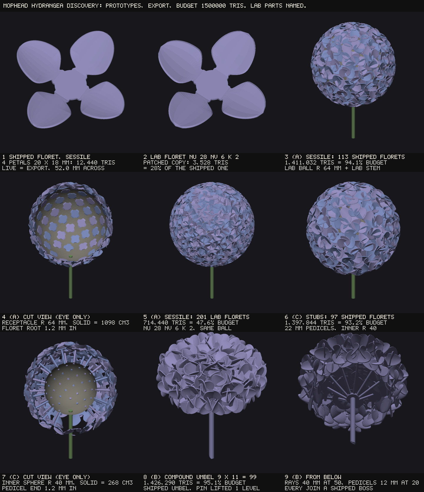

# Parametric Bloom — the mophead hydrangea, discovery

*Oct 24, 2026. Discovery only: docs and two measurement tools and a sheet. Nothing in the
generator changed — `bloom-geometry.js`, `bloom-registry.js`, `bloom.js` are untouched, and
every prototype below is built either from the SHIPPED module or from a PATCHED COPY of it
written under the OS temp directory, never the repo (the rim-roundness lab's precedent).
Eva's ruling of Oct 21 is the brief: **the mophead ball — a dense dome or ball of many small
4-petal florets, packed tight.** The question: how to build a ball of roughly 80–200 florets
that prints as one piece inside the 1,500,000-triangle export budget.*

Read with: `docs/bloom-inflorescence-discovery.md` (the twelve rulings — 1 the head owns the
capitulum, 3 Route A instancing, 4 the floret is a petal-count reduction with `NU` fixed, 7
sessile means embedded), `docs/bloom-umbel-outcome.md` (the umbel this builds on),
`docs/bloom-big-petals-outcome.md` and `docs/bloom-root-support-outcome.md` (the root law),
CLAUDE.md's SPHERE head block, issue #231.

**Every figure names its MODE and its SAMPLING** (the session-32 rule). Triangle counts are
the accumulator's own (`MeshBuilder.triangleCount`). Unless a line says otherwise the mode is
EXPORT, and for every floret and every prototype measured here **LIVE and EXPORT read the same
count** (checked: 12,440 / 12,440 on the floret, 1,426,290 / 1,426,290 on the compound umbel).
Reproduce everything with:

```
node tools/bloom-hydrangea-measure.mjs                       # §2, ~10 s, no browser
node tools/shot-bloom-hydrangea-discovery.mjs <dir> --png docs/img/hydrangea-discovery.png   # §3 + the sheet, ~3.5 min
```



---

## 0. The answer in one paragraph

**A ball of about 100–120 of today's florets fits the budget, and the three structures all
print as one closed, self-intersection-free piece; 200+ needs a reduced floret, and 8,000 is
out by two orders of magnitude.** The cheapest reachable 4-petal floret is **12,440
triangles** (four petals at 3,062 each plus a 192-triangle flat hub), sessile; any pedicel adds
**1,916** whatever its length. That is **120 florets** in 1.5 M with nothing else built, **104**
on pedicels. Three structures were prototyped and measured: (A) florets sessile on a ball
receptacle at the SPHERE head's equal-area lattice — **113 florets, 94.1 % of budget**; (B) a
compound umbel, the shipped umbel with its floret pin lifted ONE level in a patched copy so each
ray carries a headless umbel of its own — **9 × 11 = 99 florets, 95.1 %**, every join a shipped
boss; (C) florets on 22 mm stub pedicels from a hidden inner sphere — **97 florets, 93.2 %**. All
four builds (with the reduced-floret ball) are watertight (0 boundary, 0 non-manifold, 0
directed mismatch, 0 degenerate), carry **0 within-shell self-intersection pairs**, and read one
region in the 0.6 mm flood fill. **The reduced-lattice floret** (a patched floret-only row count,
the way leaves got `LEAF_BLADE_ROWS`, with fewer columns and a two-segment bead) reaches **3,528
triangles — 28 % — and 201 florets at 47.6 %**, at a measured apex chord error of 0.02 mm on a
narrow petal and **0.62 mm on a round one**, which is past the print's ~0.35–0.4 mm resolvable
detail. Two findings matter as much as the counts: **the petal range's 20 mm floor makes the
floret 52 mm across**, a quarter wider than a real mophead's florets (25–38 mm) against a 15 cm
ball; and **the flood fill cannot witness that a floret is rooted** — with the receptacle
removed, the florets alone still read ONE region in all three structures, because packed
florets fuse into each other. Whether (A) is even admissible is a ruling: it is the
"120-floret capitulum" reading ruling 1 refused.

---

## 1. The count the look needs

**References** (cultivar descriptions from US plant patents and one flora; the figures below are
quoted from the search results and the patents' own text as served there — the patent PDFs and
the flora page could not be fetched from this container, so each is cited and not re-read):

| source | head | sterile florets | floret size | note |
|---|---|---|---|---|
| Flora of New Zealand, *Hydrangea macrophylla* ([nzflora.info](https://www.nzflora.info/factsheet/taxon/Hydrangea-macrophylla.html)) | corymb up to 20 cm across, "usually largely composed of sterile fls" | — | sepals 1–2 cm, (3)4 per floret | the species frame |
| 'HYMMAD I', USPP 18,294 ([uspto](https://image-ppubs.uspto.gov/dirsearch-public/print/downloadPdf/PP18294)) | 12.5 cm across, 8 cm deep | "varies widely" | floret 38 × 38 mm; sepals 16.6 × 16.5 mm | a near-round sepal |
| 'Mini Penny', USPP 15,744 ([uspto](https://image-ppubs.uspto.gov/dirsearch-public/print/downloadPdf/PP15744)) | 9–11 cm across, 6 cm deep | — (16–18 fertile) | 2.45 cm | four sepals |
| 'Hokomapfloy', USPP 35,814 ([justia](https://patents.justia.com/patent/PP35814)) | — | **80** (+16 fertile) | 3.5 cm | per mophead |
| 'Mother's Love', USPP 28,141 ([uspto](https://image-ppubs.uspto.gov/dirsearch-public/print/downloadPdf/PP28141)) | — | **~150** (+~17 fertile) | — | |
| 'BAICZ10', USPP 37,420 ([uspto](https://image-ppubs.uspto.gov/dirsearch-public/print/downloadPdf/PP37420)) | — | ~450 (+300 fertile) | 1.5–2.5 cm | the dense extreme; the snippet does not say it is a mophead *macrophylla* |

**What that gives, derived and labelled as derived:**

* **Count: 80–150 sterile florets is the typical mophead; ~450 is a reported extreme.**
* **Floret against head: d/D ≈ 0.25–0.30** (Mini Penny 2.45 / 10 = 0.245; HYMMAD I 38 / 125 =
  0.30; the flora's 1–2 cm sepals on ≤ 20 cm heads is the same range).
* **Overlap.** A head is a dome, not a sphere: HYMMAD I's 12.5 cm × 8 cm deep is a spherical cap
  of radius 64.4 mm and area 32,370 mm², which holds **28.5** of its 38 mm florets side by side.
  80–150 florets on it is therefore a **plan coverage of about 2.8–5×** — the florets overlap two
  to five deep, which is what "packed tight" means in numbers. The florets that SHOW on the
  surface are roughly the first layer, **about 30–40 on a 12.5 cm head**; the rest are under them.
* **For a 15 cm ball** at d/D 0.25–0.30 the floret is 37–45 mm, and at coverage 2.8–5 a FULL
  sphere wants `N = 4 f (D/d)²` ≈ **125–440**, a dome (hemisphere) half that, **60–220**.

**What the bloom can make.** The petal range's floor is 20 × 8 mm (`OVERRIDE_BOUNDS`, which
`floretScale` cannot go under). Four 20 × 8 petals make a floret **37.4 mm** across; four
round-ish 20 × 18 petals — the hydrangea's sepal shape — make one **52.0 mm** across, because the
hub grows with the feet (hub radius 6.63 mm). Against a 15 cm ball that is **d/D 0.35**, coarser
than the references. At that floret the same coverage wants fewer florets — **the prototypes'
113 florets on a 147 mm ball are a plan coverage of 3.5**, inside the referenced 2.8–5 — so the
budget and the floret floor happen to agree at about a hundred. A floret closer to the real
proportion (12–14 mm sepals, ~35 mm across) would need the petal floor lowered for florets and
**about 250 florets** for the same coverage, which only the reduced floret can afford (§4).

---

## 2. Floret cost

### 2a. The cheapest reachable 4-petal floret, by part (shipped tree)

DEFAULTS plus the named set, built by `buildBloomInto` (a floret IS a head built through
`floretState`). Per-petal counts are the petal records' own `triRange`.

| floret | live | export | petals | hub + pedicel | fit in 1.5 M |
|---|---|---|---|---|---|
| 4 × 20 × 8, sessile (no stem) | 12,440 | 12,440 | 4 × 3,062 | 192 (flat hub) | **120** |
| 4 × 20 × 18, tip 2.0, cup 0.2, tilt 15, sessile | 12,440 | 12,440 | 4 × 3,062 | 192 | 120 |
| 3 × 20 × 8, sessile | 9,378 | 9,378 | 3 × 3,062 | 192 | 159 |
| 4 × 20 × 8 + 3 mm pedicel, 5 mm, flat end | 14,356 | 14,356 | 4 × 3,062 | 2,108 | **104** |
| 4 × 20 × 8 + 3 mm pedicel, 40 mm, flat end | 14,356 | 14,356 | 4 × 3,062 | 2,108 | 104 |
| 4 × 20 × 8 + domed hub (`headRise` 0.3) | 15,704 | 15,704 | 4 × 3,062 | 3,456 | 95 |

* **No shape control moves the count** below the apex ramp — width, cup, tilt and a tip shape up
  to 2.30 all read 12,440 — so the count is `petals × 3,062 + hub (+ 1,916 pedicel)`.
* **The pedicel costs 1,916 at any length** (a straight tube is two stations, plus the
  hub-to-stem join) — 15 % of a floret.
* **The ROOT LAW costs nothing here and is inert**: a floret petal is 20 mm, under
  `ROOT_TAPER_REF_MM` (35), so `petalRootTaper` returns null — the identity by branch — and it is
  a thickness law, never a lattice one, so even where it acted it would add no triangle.
* **Nothing else rides along**: DEFAULTS carry no stamen, style, sepal, leaf, infill or texture,
  and `floretState` pins a floret's own stem nodes, cut, leaves and inflorescence off.

### 2b. The apex row ramp reaches a round floret

A hydrangea sepal is broadly round; the round tip shapes are exactly where `bladeRowsFor` ramps
the rows (`APEX_NU_BAND` 2.30–2.70 → `APEX_NU_ABOVE` 112):

| `petalTipShape` | 1.70 | 2.00 | 2.30 | 2.50 | 2.70 | 3.00 |
|---|---|---|---|---|---|---|
| rows a petal | 59 | 59 | 59 | 87 | 115 | 115 |
| floret | 12,440 | 12,440 | 12,440 | 18,264 | 24,088 | 24,088 |
| fit | 120 | 120 | 120 | 82 | 62 | 62 |

The ramp is **budget-gated for the whole bloom**, so a ball that cannot afford it builds every
petal at 56 rows silently-by-design; the prototypes use tip 2.0 (the true ellipse) and stay under
the band.

### 2c. A reduced-lattice floret (patched copies, measured, chosen none)

The knobs, each a one-line patch of the copy (`tools/bloom-hydrangea-lib.mjs`): `NU_BASE` (blade
rows), `NV` (columns across, kept even), `RIM_BEAD_SEGMENTS` (K). **Chord** is the largest
half-width difference between this variant's emitted outline polyline and a 224-row build of the
same variant family, sampled at the reference's stations, EXPORT, split at u 0.10 and 0.90.
**Arc rows** are the nib's own rows (`tipCap.apex.arcU`). Every row is watertight, has 0
directed-edge mismatch, 0 degenerate triangles and **0 within-shell self-intersection pairs**.

Narrow floret, 4 × 20 × 8, flat:

| NU | NV | K | floret | petal | chord root / mid / apex (mm) | arc rows | fit |
|---|---|---|---|---|---|---|---|
| **56** | **10** | **4** | **12,440** | 3,062 | 0.069 / 0.003 / 0.006 | 6 | **120** |
| 40 | 10 | 4 | 9,112 | 2,230 | 0.122 / 0.006 / 0.013 | 7 | 164 |
| 28 | 10 | 4 | 6,616 | 1,606 | 0.201 / 0.014 / 0.023 | 5 | 226 |
| 20 | 10 | 4 | 4,952 | 1,190 | 0.143 / 0.033 / 0.074 | 5 | 302 |
| 14 | 10 | 4 | 3,704 | 878 | 0.048 / 0.051 / 0.088 | 2 | 404 |
| 56 | 6 | 4 | 8,696 | 2,126 | 0.069 / 0.003 / 0.006 | 6 | 172 |
| 56 | 10 | 2 | 10,344 | 2,538 | 0.069 / 0.003 / 0.006 | 6 | 145 |
| 56 | 6 | 2 | 6,664 | 1,618 | 0.069 / 0.003 / 0.006 | 6 | 225 |
| 40 | 6 | 2 | 4,872 | 1,170 | 0.122 / 0.006 / 0.013 | 7 | 307 |
| 28 | 6 | 2 | **3,528** | 834 | 0.201 / 0.014 / 0.023 | 5 | **425** |
| 20 | 6 | 2 | 2,632 | 610 | 0.143 / 0.033 / 0.074 | 5 | 569 |

Round floret, 4 × 20 × 18, tip 2.0, cup 0.2, tilt 15 — **the same triangle counts, much worse
chords at the apex**:

| NU | NV | K | floret | chord root / mid / apex (mm) | arc rows |
|---|---|---|---|---|---|
| 56 | 10 | 4 | 12,440 | 0.177 / 0.007 / 0.233 | 6 |
| 40 | 10 | 4 | 9,112 | 0.292 / 0.014 / **0.417** | 6 |
| 28 | 10 | 4 | 6,616 | 0.459 / 0.033 / **0.617** | 5 |
| 20 | 10 | 4 | 4,952 | 0.346 / 0.086 / **0.857** | 4 |
| 14 | 10 | 4 | 3,704 | 0.105 / 0.112 / **0.886** | 2 |
| 28 | 6 | 2 | 3,528 | 0.459 / 0.033 / 0.617 | 5 |

What the tables say:

* **The ROW count is the only knob that costs shape, and it costs it at the two ends.** Mid-blade
  the chord stays ≤ 0.09 mm at every count. The ROOT figure is the root blend's own C0 seam at
  u ≈ 0.058 (session 37's 44.5° tangent break), where whether a station lands on the kink decides
  the number — it is not monotone in NU (0.20 at 28, 0.14 at 20, 0.05 at 14) and it sits under the
  floret's own hub and its neighbours. The APEX is the one that shows: on a ROUND floret **NU 40
  reads 0.42 mm and NU 28 0.62 mm**, against the ~0.35–0.4 mm the edge-profile session took as
  Nylon 12 White's resolvable detail. On a narrow floret the apex is 0.02 mm at NU 28.
* **The nib survives every count** — it closes on every variant (`apex.active`) with 5–7 arc rows
  down to NU 20 and **2 at NU 14**, where the arc is drawn by its ends.
* **Columns and bead segments are nearly free**, and in closed form: the cup's across-row sagitta
  is `c·hb/(NV−1)²` — **0.072 mm at NV 6** for cup 0.2 on a 9 mm half-width (0.022 at NV 10) — and
  the bead's facet sagitta is `r(1 − cos(π/2K))` — **0.146 mm at K 2** on the 0.5 mm bead (0.038 at
  K 4). Both under print resolution. **NV 6 + K 2 at NU 56 is 6,664 triangles, 54 % of the shipped
  floret, with the shipped floret's own outline chords** — the cheapest reduction that costs no shape.
* **Two traps a floret-only row count would walk into, found by building it:** (i) the ramp's
  ceiling `APEX_NU_ABOVE` is an ABSOLUTE 112, so a NU-28 floret at tip 2.5 still builds 73 rows a
  petal (15,352, more than the shipped NU-56 floret at tip 2.0) — the floret's count has to own its
  ramp too; (ii) `CURL_START_MIN = 1/NU` is imported by the registry as `curlStart`'s floor and the
  curl start is floored at one blade row, so a floret at NU 28 would floor a curl start of 1/56 at
  1/28 while the head's slider says otherwise — `LEAF_BLADE_ROWS`' precedent pins the reader, and
  this reader is a curl law, so it needs saying.

### 2d. A lighter pedicel and a lighter hub

`HUB_SECTORS` (48) rounds the hub, every stem and pedicel, and the umbel boss. Patched:

| sectors | hub | pedicel + join | floret with pedicel | fit |
|---|---|---|---|---|
| **48** | 192 | 1,916 | 14,356 | 104 |
| 24 | 96 | 956 | 13,300 | 112 |
| 16 | 64 | 636 | 12,948 | 115 |
| 12 | 48 | 476 | 12,772 | 117 |

**A lighter HUB is not a lever on a flat floret** — 192 triangles is 1.5 % of it. It is one only on
a domed hub (3,456). **A lighter PEDICEL is**: 12 sides (the leaf petiole is already a 12-gon) takes
a pedicel from 1,916 to 476 and puts 13 more florets in the budget.

---

## 3. Structure — three options, prototyped

All three are assembled from **one floret built at the origin and appended N times under rigid
frames** by the shipped `MeshBuilder.appendTransformed` — ruling 3's Route A, ruling 4's floret,
O(1) floret builds. The floret is the round one (4 × 20 × 18, tip 2.0, cup 0.2, tilt 15,
52.0 mm across). **Lab parts are named:** the ball receptacles and the stem under (A) and (C) are a
closed icosphere (5,120 triangles) and a closed 48-sided tube, not shipped builders; (B) is shipped
geometry throughout.

Measured on the assembled EXPORT soup (`tools/shot-bloom-hydrangea-discovery.mjs`, the JSON
beside the sheet):

| | florets | triangles | % budget | across | boundary / nm / dir / deg | within-shell pairs | flood fill (0.6 mm) | florets ALONE, flood fill | signed volume |
|---|---|---|---|---|---|---|---|---|---|
| (A) sessile, shipped floret, receptacle R 64 | 113 of 116 | 1,411,032 | 94.1 | 147 mm | 0 / 0 / 0 / 0 | **0** | 1 region | **1 region** | 1,271 cm³ |
| (A) sessile, reduced floret (NU 28 NV 6 K 2) | 201 of 206 | 714,440 | 47.6 | 147 mm | 0 / 0 / 0 / 0 | **0** | 1 region | **1 region** | 1,399 cm³ |
| (B) compound umbel 9 × 11 | 99 | 1,426,290 | 95.1 | 133 mm | 0 / 0 / 0 / 0 | **0** | 1 region | — | 173 cm³ |
| (C) stubs 22 mm, inner sphere R 40 | 97 of 102 | 1,397,844 | 93.2 | 144 mm | 0 / 0 / 0 / 0 | **0** | 1 region | **1 region** | 434 cm³ |

("of N": the lattice asks N; the slots whose normal points into the stem channel are not built.
Signed volume is the sum over every closed shell — an UPPER bound on the union, overlapping
shells counted twice.)

### (A) Florets sessile on a ball receptacle — the SPHERE head's lattice, a floret per slot

* **Reused.** The SPHERE head's equal-area polar law (cos φ linear in the slot index, 2/K a step,
  the golden angle in azimuth — restated in the lab as `sphereLattice`); the stem channel's MASK
  (slots the stem would pass through are not built — `stemOmission`'s construction; the lab drops
  them by angle); ruling 7's sessile root law (the hub's underside on the axis, one sheet inside
  the receptacle); the floret memo and `appendTransformed`.
* **New.** A "floret" content for a whorl slot: the slot builder appends a placed floret where it
  calls `buildPetalInto` today. **This IS the capitulum-of-florets reading ruling 1 refused** ("the
  head owns the capitulum; the inflorescence never assembles a floret disc"; to revisit only if one
  centre reads wrong at print size). A mophead is botanically a corymbose cyme of separate florets,
  not a capitulum, so the refusal's grounds do not obviously transfer — but it is a ruling, not a
  measurement.
* **The receptacle.** The shipped SPHERE hub is two concentric spheres with apex fans — **a hollow
  shell, i.e. a sealed cavity** (6,720 triangles). A solid ball is the lab's choice here; §5.
* **Connection.** Every floret's hub is embedded 1.2 mm; the flat hub's rim lifts off a 64 mm
  sphere by `r²/2R` = 0.34 mm at its 6.63 mm rim, so it stays 0.86 mm in. The stem roots into the
  receptacle at the reserved pole.
* **Mode-freeness.** The lattice, the receptacle radius and the reserve read controls only; the
  floret unit is built per mode and both modes count the same. The EMBED reads the sheet, which the
  export floors — at a sheet under 1.0 mm the root depth would differ by mode, so it must be a
  mode-free length (the larger mode's, the stem channel's union rule) — topology may not be
  mode-dependent (refused repeatedly in this project).
* **Gates it would need.** An equal-area clause (S1's, re-pointed at floret centres); the channel
  (ST7–ST9); ID3/ID5's rigid-placement residual; X2's census; XR1 for a refusal; and **a per-floret
  ROOT clause (UM2's shape: every floret's emitted root disc inside the receptacle)** — required,
  not optional, because **the flood fill cannot see an unrooted floret: the florets alone, with the
  receptacle deleted, read one region** (measured, all three structures). The J-family lesson
  ("a green connectedness run does not endorse the junction") one scale up.

### (B) A compound umbel — inflorescence depth 2

* **What was built.** The shipped umbel with ONE line changed in a patched copy: `floretState`'s
  `PEDICEL_PINS.inflorescence: 'NONE'` is lifted for one level, so each floret of the primary umbel
  is built as a headless UMBEL of its own — its own stem IS the primary ray (3 mm, the area rule
  floored), its own boss, pedicels and florets are the shipped umbel's, recursion capped at one by
  a marker on the inner state (the flower's bud capped its recursion the same way). Primary: 9 rays
  of 40 mm at 50°; secondary: 11 pedicels of 12 mm at 20°. **Every join is a shipped boss**, every
  root disc inside it by the umbel's own construction.
* **Reused.** Everything: `inflorescencePlan`, `umbelBoss` (192 triangles a boss), the area rule,
  `floretUnitMemo`, `pedicelPlacement`, UM0–UM4's subject.
  The count is exact before the appends: one sub-umbel is 158,392 (11 × 14,356 + 2,476 for its ray
  and boss), the whole is 9 × 158,392 + 762 (main stem and boss).
* **New.** Per-level controls (ruling 2's "generated `Level k` sections"), the metrics hook per
  level, and the depth itself — build 1 deferred depth 2 to "group D, after cymes and the openness
  ramp". The prototype shows the geometry is one line; the cost is the panel and the gates.
* **The shape it makes is a DOME, open below** — which is what a mophead is (HYMMAD I: 12.5 × 8 cm
  deep), and it is the most hydrangea-like of the three on the sheet. One elevation per level makes
  rings of florets, not a ball: a closed BALL from umbels needs pedicels at several elevations,
  which the umbel's single `pedicelAngle` cannot give (an *Allium*'s ball is that missing law).
* **Mode-freeness.** Inherited: live and export build 1,426,290 triangles to the same bounding box.
* **Gates.** UM0–UM4 at each boss (UM2 is exactly the root clause (A) lacks); ID1–ID10 per level;
  the combination gate's floret-floret measure (an umbel's florets overlap by construction —
  already declared by value); a depth clause; a budget clause.
* **Print.** No receptacle, no cavity, powder drains between the florets.

### (C) Florets on stub pedicels from a hidden inner sphere

* **Reused.** The floret with its own stem (the pedicel IS the floret's stem, shipped); the
  sphere lattice and channel as (A).
* **New.** A receptacle that is not a head (a hidden inner sphere), and rods placed NORMAL to a
  sphere — no shipped law does that for whole florets (the androecium's rods stand on `surfaceAt`
  normals, one scale down). The root clause is the leaf petiole's (LF18 / T6: the emitted root ring
  inside the solid).
* **Connection.** Each pedicel's flat end sits 1.2 mm inside the inner sphere (sagitta of a 1.5 mm
  disc on a 40 mm sphere: 0.03 mm). Same blindness as (A): florets alone read one region.
* **Print.** A much smaller receptacle than (A) — the inner sphere is 268 cm³ solid, against 1,098.

---

## 4. Budget ways out, costed

| way out | floret | florets in 1.5 M | costs |
|---|---|---|---|
| none — today's floret, sessile | 12,440 | **120** | — |
| today's floret on a pedicel | 14,356 | 104 | — |
| **a lighter pedicel** (12 sectors) | 12,772 | 117 | a stem round count that differs from the main stem's |
| **a lighter hub** | 12,296 at 12 sectors | 121 | nothing worth having on a flat hub (1.5 %) |
| **NV 6 + K 2 at NU 56** | 6,664 | **225** | below print resolution on both (§2c); two new floret-only constants |
| NU 40, NV 6, K 2 | 4,872 | 307 | round apex 0.42 mm |
| NU 28, NV 6, K 2 | 3,528 | **425** | round apex 0.62 mm — visible; narrow apex fine |
| NU 20, NV 6, K 2 | 2,632 | 569 | round apex 0.86 mm |
| fewer, larger florets | — | — | already at the floor: the 20 mm petal floor makes the floret 52 mm; larger only lowers the count further |
| 3 petals instead of 4 | 9,378 | 159 | not a hydrangea |

**What IS in:** about **100–120 florets** at today's floret, **~225** with the shape-free reduction
(NV 6, K 2), **~300–425** with a row reduction that costs a round apex, and **~570** at the
smallest floret measured. **8,000+ is out** by a factor of 14 even at the smallest — it would need
a floret under 190 triangles, i.e. no petals worth the name.

**Does #231 have to land first? No — for these structures the count is exact before the
appends.** #231 asks for a predictor of a WHOLE bloom's count, which is hard because the count is
decided inside the builders. Here the floret is built ONCE and appended N times, so
`N × unit + fixed` IS the accumulator's own number after one unit build — not a second owner of
the count, the umbel's existing O(1) structure. A ball builder can therefore CLAMP the floret count
to the budget (told, never silent) before appending, the way the texture edge cap decides over
trial builds; the export refusal path would never be reached by a ball. #231 stays what it is: the
cost of a refusal on configurations that are not instanced.

---

## 5. Print — SLS PA12, a 15 cm ball

**Densities used** (datasheet figures, not measured here): laser-sintered PA12 parts about
**0.93 g/cm³** (EOS PA 2200), loose PA12 powder about **0.44 g/cm³**. Masses from the signed
volumes above (upper bounds — overlaps counted twice).

| structure | solid receptacle | mass, solid | receptacle as a 2 mm shell | mass, shell | sealed cavity | trapped powder if sealed |
|---|---|---|---|---|---|---|
| (A) R 64 | 1,098 cm³ | **~1.18 kg** | 100 cm³ | ~250 g | 998 cm³ | **~440 g** |
| (B) none | — | **~160 g** | — | — | (stem bores only, < 1 cm³) | ~0 |
| (C) inner R 40 | 268 cm³ | **~400 g** | 38 cm³ | ~190 g | 230 cm³ | ~100 g |

* **A closed ball traps powder.** In SLS an enclosed cavity is not a print failure — it prints full
  of unsintered powder that cannot be removed. The shipped generator ALREADY does this: the SPHERE
  head's hub is two concentric spheres (a sealed shell), and the solid-plug ruling (the stem's tip
  plug and root band, Eva: *"i want the bottom of the stem when it is a bored cylinder to still look
  solid"*) seals every hollow
  stem's bore at both ends — both declared as O1's inward cavity shell, neither ever discussed as
  powder. At hub and stem scale it is grams; at ball scale it is half a kilogram.
* **Escape holes.** SLS design guidance converges on **at least two holes of ≥ 3.5 mm per enclosed
  cavity** ([Facfox](https://facfox.com/docs/?p=163374), [Xometry](https://xometry.eu/en/?p=1593),
  [Reiman's SLS guidelines](https://additive.reiman.pt/wp-content/uploads/2025/09/Design-Guidelines-SLS.pdf);
  [JLC3DP](https://jlc3dp.com/help/article/3d-printing-design-guideline) allows 2.5 mm). A hollow
  receptacle can hide them: the reserved stem pole is one (if the stem's bore is left open into the
  cavity), and any other must sit under a floret's hub where a floret is not built — the stem
  channel's mask is the mechanism that would make room, at the cost of a floret per hole.
* **Depowdering the florets themselves.** At a plan coverage of 3.5 the florets overlap three to
  four deep with 1.2 mm sheets; the gaps are open (no cavity) but deep and narrow. (B) has no
  receptacle and drains best; (A) the worst. This is a coupon question — **nothing in this project
  has been printed**, and every floor here is a declared guess.
* **One piece:** all three print as one connected body (the flood fill reads one region), but see
  §3 — that reading cannot distinguish rooted from merely touching florets, so it is not evidence
  that each floret is held by its root.

---

## 6. Findings recorded on the way

1. **The flood fill is blind to rooting on a packed ball.** Florets alone read one region in (A),
   (A-reduced) and (C). Any build owes a per-floret root clause; UM2 already is one for (B).
2. **The petal floor sets the floret at 52 mm** (round) / 37 mm (narrow): coarser than the
   referenced 25–38 mm against a 15 cm ball. Below 20 mm is outside the shipped petal range.
3. **The shipped SPHERE hub and every plugged stem bore are sealed cavities** — trapped powder,
   pre-existing, never named as such.
4. **A floret-only row count has two readers to pin** besides the blade: the apex ramp's absolute
   112 and `CURL_START_MIN` (§2c).
5. **Depth 2 is one line of geometry** (`floretState`'s pin), measured watertight and fold-free on
   99 florets — what it costs is panel and gates, not geometry.
6. **The umbel's single elevation makes a dome, not a ball**; a ball from umbels needs a per-ray
   elevation law.

---

## 7. Questions for Eva

1. **Structure.** (A) a ball receptacle with sessile florets (reopens ruling 1 — florets assembled
   on a receptacle), (B) a compound umbel at depth 2 (a DOME, open below; reopens ruling 5's order —
   depth 2 before cymes), or (C) stubs from a hidden inner sphere? On the sheet (B) reads most like a
   mophead and prints lightest.
2. **Ball or dome.** A real mophead is a dome (8 cm deep on 12.5 cm). Is the ruling's "ball" a full
   sphere or the dome?
3. **The floret size.** Keep the 20 mm petal floor (52 mm florets, ~100 of them) or allow a
   floret-only petal range down to ~12–14 mm (~35 mm florets, ~250 of them, which needs the reduced
   floret)?
4. **The reduced floret.** Take the shape-free reduction (NV 6 + K 2, 6,664 triangles, ~225 florets)
   — a second ruled exception to "derive, don't expose" beside `NU` (ruling 4 said `NU` stays fixed
   and the floret is a petal-count reduction only)? And the row reduction too (NU 28/40), accepting a
   0.4–0.6 mm faceted round apex?
5. **The receptacle, for (A)/(C).** Solid (heavy: ~1.2 kg for (A)), or a shell with ≥ 2 escape
   holes of ≥ 3.5 mm hidden under omitted florets? And the pre-existing sealed cavities (SPHERE hub,
   plugged stem bores) — leave, or open them?
6. **The count clamp.** When a ball asks for more florets than the budget holds, clamp the count to
   the budget and tell (computable exactly from one floret build), or refuse?

---

*Tools: `tools/bloom-hydrangea-lib.mjs` (the patched-copy loader with the `nu` / `nv` / `k` /
`sectors` / `depth2` knobs — every anchor must match exactly once or it refuses, and the identity
variant is asserted to be the shipped text — plus the sphere lattice, the rigid frame, the edge
census and a 0.6 mm flood fill), `tools/bloom-hydrangea-measure.mjs` (§2),
`tools/shot-bloom-hydrangea-discovery.mjs` (§3 and the sheet; `--quick` skips the census and the
flood fill; it caches each cell's JSON in the out dir). The renderer is
`tools/bloom-soft-render.mjs`, deterministic, so no pixel delta is quoted and none is owed. None of
these runs in CI and none is imported by the generator.*
