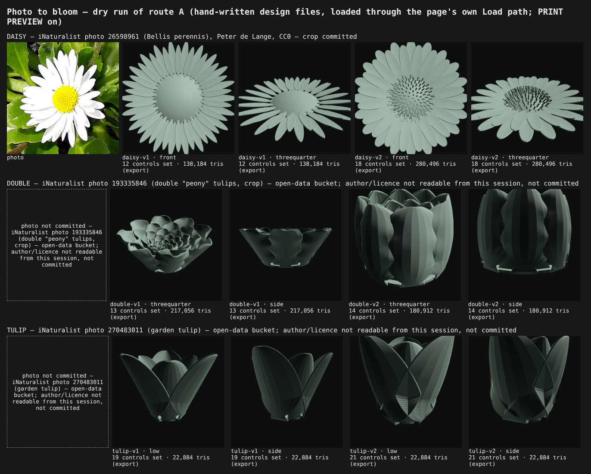
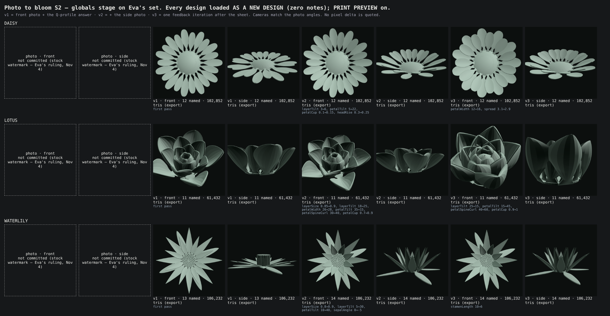
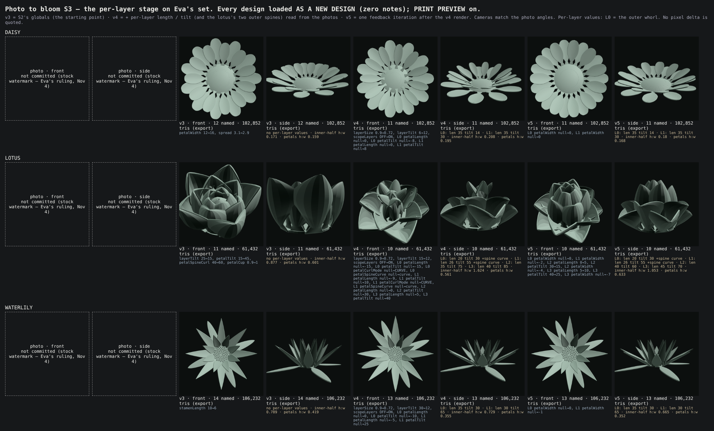

# Photo to bloom — discovery (Nov 3)

**What this is.** A discovery for a feature where Eva pastes a photo of a flower and gets a bloom
design file that approximates it, with a few clarifying questions asked only when the photo cannot
answer something that matters. **Nothing ships.** No file the page loads was changed:
`bloom.html`, `bloom.js`, `bloom-geometry.js`, `bloom-registry.js`, `bloom-file.js` and
`netlify/` are untouched (predeclared, checked by `git diff --stat` at close). The PR adds this doc,
two throwaway tools, six hand-written design subsets, the six design files they compose to, one
CC0 photo crop and one sheet.

| file | what |
|---|---|
| `tools/bloom-photo-census.mjs` | the census (§1) and the schema (§2), checked against the registry both ways; `--md` prints the tables below |
| `tools/bloom-photo-dryrun.mjs` | the dry run (§6): subset → complete design file → loaded through the page's own Load path → rendered; `--sheet` composes the sheet |
| `docs/photo-to-bloom/*.subset.json` | what route A would write, by hand, for three flowers, two passes each |
| `docs/photo-to-bloom/*.bloom-design.json` | the complete `bloom-design` v1 files those compose to (loadable on `/bloom` as they are) |
| `docs/img/photo-to-bloom-dry-run.png` | the sheet (the tulip photos are placeholders — §6.1) |

**Eva ruled on all eight open questions on Nov 3 — §7.** The questions as asked are kept below the rulings.

**S1 is built (§9):** load as new design, the subset validator, the sidecar format, and the status check that gates the staged v1 scope.

**S2 — the globals stage on Eva's own photos — is §10.** Whether the globals PASS is Eva's ruling from the sheet; this doc does not decide it.

---

## 0. Premises checked before building on them

| premise in the brief | measured |
|---|---|
| "round-trip through the existing saved-design load path, including the **silent** clamping rules already ruled for out-of-range values" | **Half true.** The design-file reader (`bloom-file.js`) clamps an out-of-range slider and snaps an off-step one — and **TELLS**, as a `clamped` note on the status line; a bad choice is `invalid` and not applied. The only *silent* clamp is the sepal twins' (`SEPAL_TWIN_BOUNDS`: a saved `sepalRoll` past ±180 builds at ±180 with no note — Eva's Q-S6 ruling, Oct 9), applied in the geometry, not the reader. So the feature's acceptance check can be strict: **a design it emits must load with zero notes** (§2.4). All six dry-run files did: 201 of 201 controls applied, 0 notes. |
| a subset file is a design file | **No.** Rule 3 of the reader: *a missing field is reported and the page keeps what it has.* A file naming 15 controls loaded onto a page that holds another design keeps the other 186 — the new flower inherits the old one's leftovers, plus 186 `missing` notes. The dry run composes every subset over `DEFAULTS` with the reader's own writer (`composeDoc`) — §2.3, and a question for Eva (Q2). |
| route B "does to the flat no-build stack" something new | **The stack already has a Function.** `netlify.toml` declares `netlify/functions`, `designs.mjs` is a public, rate-limited, Blobs-backed endpoint for the Flower gallery, and `package.json` exists so Netlify installs its dependency at deploy. Route B would be a second Function on an existing pattern, not a first server (§5). |
| photos are available | **Not from this session.** The proxy refuses Wikimedia, iNaturalist's site and API, Unsplash and Flickr; it allows iNaturalist's **open-data** S3 bucket, which serves photos by id with no metadata. One CC0 photo was identified through a Commons file page (search result, verify before reuse); two more were picked by eye from a random sample of the bucket, and their author and licence could not be read here — they are used for the session's own comparison and **not committed** (§6.1). |

---

## 1. Parameter census

201 user-facing controls (`CONTROLS` in `bloom-registry.js`: 168 sliders, 26 choices, 7 curves), every
one classified. The table is printed by `node tools/bloom-photo-census.mjs --md`, which **refuses to
print** if a registry control is unclassified or a classified id is not a control (seen failing: a
copy with `nodeVariance` deleted reads `CENSUS INVALID: unclassified controls: nodeVariance`).

- **a** — readable from ONE front or three-quarter photo
- **b** — readable only from a SIDE view or a SECOND photo (underneath, the stem, a leaf)
- **c** — not inferable from a photo: leave at the default, or ASK
- **d** — print / infrastructure / editor state: **never set by this feature**

**Totals: a 49 · b 102 · c 27 · d 23.** The b column is large because the stem, leaves and sepals
are whole-plant structures (74 of the 102 are stem/leaf/leaflet/sepal controls); a face-on flower
photo reads almost none of them.

**Never written, beyond class d:**

- **`petalTexture`'s `PEBBLE` and `CELLULAR`** are hidden options (kept so old designs load). The
  census refuses a schema row that could emit one.
- **`infillBase`** is hidden at every state by a never-true predicate (parked by ruling). It is d.
- **`scopeLayers` / `scopePetals`** are editor toggles. v1 writes no scopes, so they stay `OFF`.
- **A control hidden by its own predicate under the emitted state** (163 of 201 are hidden at
  `DEFAULTS`) is hidden AND inert, so writing it is harmless but meaningless. The schema emits a
  control only where its predicate is true under the state being emitted (§2.2).
- **`umbelDepth`'s depth-2 overlay** is written only by a HAND switch; a load never writes it.
  A route that wants a mophead must write the overlay's values itself.

<details><summary>The full table (201 rows)</summary>

| control | kind | section | range / options | default | class | why |
|---|---|---|---|---|---|---|
| `petalCount` | slider | Arrangement | 3..40 | 8 | **a** | count the petals of one whorl |
| `petalLength` | slider | petal › Petal shape | 20..100 | 35 | **c** | ABSOLUTE millimetres — a photo carries proportions, never scale; the length is the anchor every other size is read against |
| `petalWidth` | slider | petal › Petal shape | 8..46 | 16 | **a** | read as width / length against petalLength |
| `petalOutlineMode` | choice | petal › Petal shape | LAW / CURVE | "LAW" | **a** | LAW unless the outline needs the drawn curve |
| `petalOutlineCurve` | curve | petal › Petal shape | curve | {"mode":"symmetric | **a** | the petal outline traced from a face-on petal (a later schema; v1 stays LAW) — _hidden at defaults_ |
| `petalBaseTaper` | slider | petal › Petal shape | 0.3..3 | 1 | **a** | how the petal narrows into its claw |
| `petalTipShape` | slider | petal › Petal shape | 0.6..3 | 1.7 | **a** | pointed / round / held-width tip |
| `petalTipTaper` | slider | petal › Petal shape | 0.6..4 | 1.8 | **a** | where the widest point sits along the petal |
| `petalTipEnd` | slider | petal › Petal shape | 0..1 | 0 | **a** | a squared tip (carnation) |
| `fringeCount` | slider | petal › Petal shape › Fringe | 0..10 | 0 | **a** | carnation-style teeth at the tip |
| `fringeDepth` | slider | petal › Petal shape › Fringe | 0.05..0.5 | 0.2 | **a** | how deep the fringe runs — _hidden at defaults_ |
| `lobeDepth` | slider | petal › Petal shape › Lobes | 0..1 | 0 | **a** | notched / lobed margins |
| `lobeCount` | slider | petal › Petal shape › Lobes | 1..10 | 6 | **a** | how many teeth — _hidden at defaults_ |
| `lobeCoverage` | slider | petal › Petal shape › Lobes | 0.1..1 | 0.8 | **a** | how far round the margin the teeth run — _hidden at defaults_ |
| `petalInfill` | choice | petal › Infill | NONE / VORONOI | "NONE" | **d** | a Voronoi lattice — decoration, never in a photo; never set |
| `infillDensity` | slider | petal › Infill | 8..40 | 20 | **d** | infill — _hidden at defaults_ |
| `infillRelax` | slider | petal › Infill | 0..12 | 5 | **d** | infill — _hidden at defaults_ |
| `infillLaw` | slider | petal › Infill | 0..2 | 0.3 | **d** | infill — _hidden at defaults_ |
| `infillAniso` | slider | petal › Infill | 1..3 | 1.65 | **d** | infill — _hidden at defaults_ |
| `infillRound` | slider | petal › Infill | 0..1 | 0.6 | **d** | infill — _hidden at defaults_ |
| `infillBase` | slider | petal › Infill | 0..1 | 0 | **d** | infill — and hidden by a never-true predicate (parked) — _HIDDEN ALWAYS (never-true predicate)_ |
| `petalTexture` | choice | petal › Texture | NONE / BONE / PEBBLE (hidden) / CELLULAR (hidden) | "NONE" | **d** | a printed surface texture — decoration; never set (PEBBLE / CELLULAR are hidden options and must never be written) — _has hidden options_ |
| `textureHeight` | slider | petal › Texture | 0.4..2.5 | 0.4 | **d** | texture — _hidden at defaults_ |
| `textureSize` | slider | petal › Texture | 1.6..12 | 4 | **d** | texture — _hidden at defaults_ |
| `bonePoreSize` | slider | petal › Texture | 0.5..1 | 0.5 | **d** | texture — _hidden at defaults_ |
| `bonePoreDensity` | slider | petal › Texture | 0.2..1 | 0.9 | **d** | texture — _hidden at defaults_ |
| `boneBandRatio` | slider | petal › Texture | 1.5..3 | 3 | **d** | texture — _hidden at defaults_ |
| `bonePatchCoverage` | slider | petal › Texture | 0.1..1 | 0.6 | **d** | texture — _hidden at defaults_ |
| `boneCurvature` | slider | petal › Texture | 0.2..4 | 1 | **d** | texture — _hidden at defaults_ |
| `tubeLayer1` | slider | petal › Tube | 0..40 | 40 | **b** | a fused corolla (bellflower, morning glory) — how far up the petals are joined; from the side |
| `tubeLayer2` | slider | petal › Tube | 0..40 | 40 | **b** | tube, layer 2 — _hidden at defaults_ |
| `tubeLayer3` | slider | petal › Tube | 0..40 | 40 | **b** | tube, layer 3 — _hidden at defaults_ |
| `tubeLayer4` | slider | petal › Tube | 0..40 | 40 | **b** | tube, layer 4 — _hidden at defaults_ |
| `tubeLayer5` | slider | petal › Tube | 0..40 | 40 | **b** | tube, layer 5 — _hidden at defaults_ |
| `tubeLayer6` | slider | petal › Tube | 0..40 | 40 | **b** | tube, layer 6 — _hidden at defaults_ |
| `tubeHeight` | slider | petal › Tube › Fusion | 0.1..0.7 | 0.25 | **b** | fusion height — _hidden at defaults_ |
| `tubeBlend` | slider | petal › Tube › Fusion | 0..1 | 1 | **b** | how the fusion blends — _hidden at defaults_ |
| `lobeCrestShape` | slider | petal › Petal shape › Lobes | 0.6..3 | 2 | **c** | sub-millimetre tooth shape — below photo resolution in most pictures — _hidden at defaults_ |
| `lobeNotchShape` | slider | petal › Petal shape › Lobes | 0.6..3 | 2 | **c** | as the crest — _hidden at defaults_ |
| `petalCup` | slider | petal › Petal form | -0.8..1.2 | 0 | **a** | cupped across the width / reflexed — shading in a three-quarter view |
| `petalCupGradient` | slider | petal › Petal form | -0.8..1.2 | 0 | **b** | the cup varying along the length — side view |
| `buckleAmp` | slider | petal › Petal form | 0..0.6 | 0 | **a** | ruffled / wavy margin |
| `buckleFreq` | slider | petal › Petal form | 1..7 | 3 | **a** | waves along one margin — _hidden at defaults_ |
| `buckleEnv` | slider | petal › Petal form | 2..6 | 3 | **c** | how far in from the edge the ruffle reaches — rarely legible — _hidden at defaults_ |
| `petalApexSweep` | slider | petal › Petal form | 0..1 | 0 | **b** | the tip sweeping out of plane — side view |
| `petalTilt` | slider | petal › Petal curl | 0..120 | 25 | **b** | flat ↔ upright: a face-on photo foreshortens it, and tilt trades against spine curl in a 3/4 view (dry run, double) |
| `petalCurlMode` | choice | petal › Petal curl | SLIDER / CURVE | "SLIDER" | **b** | SLIDER unless the spine needs the drawn curve |
| `petalSpineCurve` | curve | petal › Petal curl | curve | {"mode":"single"," | **b** | the spine profile drawn from a side view (a later schema) — _hidden at defaults_ |
| `petalSpineCurl` | slider | petal › Petal curl | -180..360 | 0 | **b** | incurved / reflexed along the length — side view |
| `curlBias` | slider | petal › Petal curl | 0..1 | 0 | **b** | where along the length the curl happens — _hidden at defaults_ |
| `curlStart` | slider | petal › Petal curl | 0..0.95 | 0 | **b** | where the curl starts — _hidden at defaults_ |
| `petalRoll` | slider | petal › Petal form | -330..330 | 0 | **a** | quilled petals (cactus dahlia) |
| `petalRollTaper` | slider | petal › Petal form | -1..1 | 0 | **b** | the quill varying along the length — _hidden at defaults_ |
| `petalTwist` | slider | petal › Petal curl | -180..180 | 0 | **a** | pinwheel twist about the midrib |
| `sheetThickness` | slider | Part thickness | 0.6..2.4 | 1.2 | **d** | the printed sheet — a print decision, never read from a photo |
| `tipThinning` | slider | Part thickness | 0..0.8 | 0 | **d** | print |
| `footDelicacy` | slider | Part thickness | 0.25..1 | 1 | **d** | print / junction plumbing |
| `spread` | slider | Arrangement | 0.6..6 | 2 | **a** | the centre-to-petal proportion (disc diameter / flower diameter) |
| `hubShape` | choice | Head | CAP / SPHERE | "CAP" | **a** | CAP / SPHERE (a globe head: allium, globe thistle) — SPHERE only under CONTINUOUS — _hidden at defaults_ |
| `headRise` | slider | Head | 0..1 | 0 | **b** | a domed centre — visible in 3/4, measurable from the side |
| `placement` | choice | Arrangement | RADIAL / SPIRAL / CONTINUOUS / FAN | "RADIAL" | **a** | ring / spiral-packed head / continuous / mirror-symmetric fan |
| `fanPerSide` | slider | Arrangement | 1..8 | 3 | **a** | FAN only — petals each side of the plane — _hidden at defaults_ |
| `fanSpacing` | slider | Arrangement | 15..170 | 45 | **a** | FAN only — angle between neighbours — _hidden at defaults_ |
| `fanCenterPetal` | choice | Arrangement | OFF / ON | "ON" | **a** | FAN only — a petal on the mirror line or a gap — _hidden at defaults_ |
| `scopePetals` | choice | Arrangement | OFF / ON | "OFF" | **d** | editor toggle that unlocks per-petal scopes — v1 writes no scopes — _hidden at defaults_ |
| `layerCount` | slider | Arrangement | 1..6 | 1 | **a** | single / semi-double / double — but inner layers are hidden in a dense double: confidence low there |
| `layerSize` | slider | Arrangement | 0.35..0.9 | 0.72 | **a** | inner petals shorter than outer — _hidden at defaults_ |
| `layerPhase` | slider | Arrangement | 0..1 | 0.5 | **a** | inner petals staggered into the gaps or aligned — _hidden at defaults_ |
| `layerTilt` | slider | Arrangement | 0..30 | 12 | **b** | inner whorls more upright than outer — needs a side or low view — _hidden at defaults_ |
| `scopeLayers` | choice | Arrangement | OFF / ON | "OFF" | **d** | editor toggle that unlocks per-layer scopes — v1 writes no scopes |
| `varianceSize` | slider | Arrangement › Variance | 0..0.5 | 0 | **a** | irregular petal sizes around the ring |
| `varianceForm` | slider | Arrangement › Variance | 0..1 | 0 | **a** | irregular curl / cup / twist around the ring |
| `varianceSpacing` | slider | Arrangement › Variance | 0..0.9 | 0 | **a** | irregular spacing |
| `varianceFrequency` | slider | Arrangement › Variance | 0..20 | 1 | **c** | a wave law over the ring — a photo shows irregularity, not its frequency — _hidden at defaults_ |
| `variancePhase` | slider | Arrangement › Variance | 0..360 | 0 | **c** | where the wave starts — not meaningful from a photo — _hidden at defaults_ |
| `stamenCount` | slider | Center › Androecium | 0..120 | 0 | **a** | a visible ring or disc of stamens — counted roughly |
| `stamenLayout` | choice | Center › Androecium | RING / DISC | "RING" | **a** | ring or disc — _hidden at defaults_ |
| `stamenSpread` | slider | Center › Androecium | 0.6..6 | 2 | **a** | how wide the stamen ring stands — _hidden at defaults_ |
| `stamenLength` | slider | Center › Androecium | 5..120 | 20 | **b** | stamen length against the petal — 3/4 or side — _hidden at defaults_ |
| `stamenLengthVariance` | slider | Center › Androecium | 0..1 | 0 | **a** | uneven stamen lengths — _hidden at defaults_ |
| `stamenCurl` | slider | Center › Androecium | -180..180 | 0 | **b** | stamens curving — side — _hidden at defaults_ |
| `stamenCoil` | choice | Center › Androecium | NONE / INDEPENDENT / BRAIDED | "NONE" | **a** | coiled / braided filaments — _hidden at defaults_ |
| `stamenCoilRadius` | slider | Center › Androecium | 0..10 | 1.5 | **c** | coil detail — _hidden at defaults_ |
| `stamenCoilTurns` | slider | Center › Androecium | 0.5..12 | 3 | **c** | coil detail — _hidden at defaults_ |
| `antherSize` | slider | Center › Androecium › Anther | 0.6..6 | 1.6 | **a** | anther size against the filament — _hidden at defaults_ |
| `antherElongation` | slider | Center › Androecium › Anther | 1..6 | 2.5 | **c** | sub-mm anther detail — _hidden at defaults_ |
| `antherRoundedness` | slider | Center › Androecium › Anther | 0..1 | 1 | **c** | sub-mm anther detail — _hidden at defaults_ |
| `antherPoints` | slider | Center › Androecium › Anther | 2..12 | 4 | **c** | sub-mm anther detail — _hidden at defaults_ |
| `antherPinch` | slider | Center › Androecium › Anther | 0.05..7 | 1 | **c** | sub-mm anther detail — _hidden at defaults_ |
| `antherLumps` | slider | Center › Androecium › Anther | 1..6 | 1 | **c** | sub-mm anther detail — _hidden at defaults_ |
| `antherSpread` | slider | Center › Androecium › Anther | 0..90 | 0 | **c** | sub-mm anther detail — _hidden at defaults_ |
| `stigmaSize` | slider | Center › Gynoecium › Stigma | 0.6..6 | 1.6 | **a** | stigma size — _hidden at defaults_ |
| `stigmaElongation` | slider | Center › Gynoecium › Stigma | 1..6 | 2.5 | **c** | sub-mm — _hidden at defaults_ |
| `stigmaRoundedness` | slider | Center › Gynoecium › Stigma | 0..1 | 1 | **c** | sub-mm — _hidden at defaults_ |
| `stigmaPoints` | slider | Center › Gynoecium › Stigma | 2..12 | 4 | **c** | sub-mm — _hidden at defaults_ |
| `stigmaPinch` | slider | Center › Gynoecium › Stigma | 0.05..7 | 1 | **c** | sub-mm — _hidden at defaults_ |
| `stigmaLumps` | slider | Center › Gynoecium › Stigma | 1..6 | 3 | **a** | lobes of the stigma (a tulip's three) — _hidden at defaults_ |
| `stigmaSpread` | slider | Center › Gynoecium › Stigma | 0..90 | 40 | **c** | sub-mm lobe splay — _hidden at defaults_ |
| `gynoecium` | choice | Center › Gynoecium | NONE / STYLE | "NONE" | **a** | a visible style |
| `styleLength` | slider | Center › Gynoecium | 5..40 | 25 | **b** | style length — side — _hidden at defaults_ |
| `styleCurl` | slider | Center › Gynoecium | -180..180 | 0 | **b** | style curvature — side — _hidden at defaults_ |
| `sepalCount` | slider | Sepals | 0..40 | 0 | **b** | sepals sit under the petals — a side or underneath photo |
| `sepalTiers` | slider | Sepals | 1..4 | 1 | **b** | stacked sepal tiers — side — _hidden at defaults_ |
| `sepalScale` | slider | Sepals | 0.2..1 | 0.6 | **b** | sepal size — _hidden at defaults_ |
| `sepalLength` | slider | Sepals | 0..120 | 0 | **b** | sepal length — _hidden at defaults_ |
| `sepalWidth` | slider | Sepals | 0..30 | 0 | **b** | sepal width — _hidden at defaults_ |
| `sepalHeight` | slider | Sepals | 0..1 | 0.75 | **d** | where the sepals attach down the hub-to-stem join — plumbing — _hidden at defaults_ |
| `sepalPhase` | slider | Sepals | 0..1 | 0.5 | **b** | sepals between or behind the petals — _hidden at defaults_ |
| `sepalFootBreadth` | slider | Sepals | 0.25..1.5 | 1 | **d** | junction plumbing — _hidden at defaults_ |
| `sepalAngle` | slider | Sepals › Sepal curl | -90..90 | 0 | **b** | sepal angle — side — _hidden at defaults_ |
| `sepalOutlineMode` | choice | Sepals › Sepal shape | LAW / CURVE | "LAW" | **b** | sepal outline — _hidden at defaults_ |
| `sepalOutlineCurve` | curve | Sepals › Sepal shape | curve | {"mode":"symmetric | **b** | sepal outline curve — _hidden at defaults_ |
| `sepalBaseTaper` | slider | Sepals › Sepal shape | 0.3..3 | 1 | **b** | sepal shape — _hidden at defaults_ |
| `sepalTipShape` | slider | Sepals › Sepal shape | 0.6..3 | 1.7 | **b** | sepal shape — _hidden at defaults_ |
| `sepalTipTaper` | slider | Sepals › Sepal shape | 0.6..4 | 1.8 | **b** | sepal shape — _hidden at defaults_ |
| `sepalCup` | slider | Sepals › Sepal form | -0.8..1.2 | 0 | **b** | sepal form — _hidden at defaults_ |
| `sepalCupGradient` | slider | Sepals › Sepal form | -0.8..1.2 | 0 | **b** | sepal form — _hidden at defaults_ |
| `sepalBuckleAmp` | slider | Sepals › Sepal form | 0..0.6 | 0 | **b** | sepal form — _hidden at defaults_ |
| `sepalBuckleFreq` | slider | Sepals › Sepal form | 1..7 | 3 | **b** | sepal form — _hidden at defaults_ |
| `sepalBuckleEnv` | slider | Sepals › Sepal form | 2..6 | 3 | **c** | sepal form detail — _hidden at defaults_ |
| `sepalApexSweep` | slider | Sepals › Sepal form | 0..1 | 0 | **b** | sepal form — _hidden at defaults_ |
| `sepalRoll` | slider | Sepals › Sepal form | -180..180 | 0 | **b** | sepal form — _hidden at defaults_ |
| `sepalRollTaper` | slider | Sepals › Sepal form | -1..1 | 0 | **b** | sepal form — _hidden at defaults_ |
| `sepalCurlMode` | choice | Sepals › Sepal curl | SLIDER / CURVE | "SLIDER" | **b** | sepal curl — _hidden at defaults_ |
| `sepalSpineCurve` | curve | Sepals › Sepal curl | curve | {"mode":"single"," | **b** | sepal curl — _hidden at defaults_ |
| `sepalSpineCurl` | slider | Sepals › Sepal curl | -180..360 | 0 | **b** | sepal curl — _hidden at defaults_ |
| `sepalCurlBias` | slider | Sepals › Sepal curl | 0..1 | 0 | **b** | sepal curl — _hidden at defaults_ |
| `sepalCurlStart` | slider | Sepals › Sepal curl | 0..0.95 | 0 | **b** | sepal curl — _hidden at defaults_ |
| `sepalTwist` | slider | Sepals › Sepal curl | -180..180 | 0 | **b** | sepal curl — _hidden at defaults_ |
| `stemLength` | slider | Stem | 0..120 | 0 | **c** | ABSOLUTE length, and whether to print a stem at all — a design choice; photos crop stems |
| `stemDiameter` | slider | Stem | 3..12 | 6 | **c** | absolute — ask, or the default — _hidden at defaults_ |
| `stemCut` | choice | Stem | FLORIST / FLAT | "FLORIST" | **d** | how the printed stem ends — fabrication — _hidden at defaults_ |
| `stemNodeSwelling` | slider | Stem | 0..1 | 0 | **b** | nodes on the stem — a whole-plant photo — _hidden at defaults_ |
| `stemNodeKink` | slider | Stem | 0..1 | 0 | **b** | a zigzag stem — whole-plant photo — _hidden at defaults_ |
| `leafNodes` | slider | Stem | 1..8 | 3 | **b** | nodes / leaves up the stem — whole-plant photo — _hidden at defaults_ |
| `leafPhyllotaxy` | choice | Stem | alternate / opposite / whorled | "alternate" | **b** | leaf arrangement — _hidden at defaults_ |
| `leafDivergence` | slider | Stem | 90..180 | 180 | **b** | leaf divergence — _hidden at defaults_ |
| `leafNodeStart` | slider | Stem | 0.05..0.95 | 0.16 | **b** | where the leaves start — _hidden at defaults_ |
| `leafNodeEnd` | slider | Stem | 0.05..0.95 | 0.86 | **b** | where they stop — _hidden at defaults_ |
| `leafNodeSpacing` | slider | Stem | -1..1 | 0 | **b** | crowding of the nodes — _hidden at defaults_ |
| `hubStyle` | choice | Stem › Hub | GOBLET / ANGLED / CURVED | "CURVED" | **b** | the receptacle's silhouette under the head — side view — _hidden at defaults_ |
| `hubShapeAmount` | slider | Stem › Hub | 0..2 | 0.5 | **b** | receptacle — _hidden at defaults_ |
| `hubLength` | slider | Stem › Hub | 0..40 | 0 | **b** | receptacle — _hidden at defaults_ |
| `leafLength` | slider | Stem › Leaves | 0..120 | 0 | **b** | a leaf photo (absolute length is c) — _hidden at defaults_ |
| `leafType` | choice | Stem › Leaves | SIMPLE / COMPOUND / LOBED | "SIMPLE" | **b** | simple / compound / lobed — leaf photo — _hidden at defaults_ |
| `leafWidth` | slider | Stem › Leaves | 3..40 | 17 | **b** | leaf — _hidden at defaults_ |
| `lobedWidth` | slider | Stem › Leaves | 3..40 | 34 | **b** | leaf — _hidden at defaults_ |
| `leafAngle` | slider | Stem › Leaves | -60..90 | 35 | **b** | leaf angle off the stem — _hidden at defaults_ |
| `leafSizeTaper` | slider | Stem › Leaves | -0.75..0.75 | 0 | **b** | leaves smaller up the stem — _hidden at defaults_ |
| `leafCurlMode` | choice | Stem › Leaves | SLIDER / CURVE | "SLIDER" | **b** | leaf — _hidden at defaults_ |
| `leafSpineCurve` | curve | Stem › Leaves | curve | {"mode":"single"," | **b** | leaf — _hidden at defaults_ |
| `leafArch` | slider | Stem › Leaves | -90..180 | 0 | **b** | leaf arch — _hidden at defaults_ |
| `leafCup` | slider | Stem › Leaves | -0.8..1.2 | 0.35 | **b** | leaf cup — _hidden at defaults_ |
| `leafOutlineMode` | choice | Stem › Leaves | LAW / CURVE | "LAW" | **b** | leaf — _hidden at defaults_ |
| `leafOutlineCurve` | curve | Stem › Leaves | curve | {"mode":"symmetric | **b** | leaf outline traced from a leaf photo — _hidden at defaults_ |
| `leafTipShape` | slider | Stem › Leaves | 0.6..3 | 1.3 | **b** | leaf — _hidden at defaults_ |
| `leafletPairs` | slider | Stem › Leaves › Leaflets | 1..4 | 2 | **b** | compound leaf — _hidden at defaults_ |
| `leafletFirst` | slider | Stem › Leaves › Leaflets | 0.05..0.45 | 0.15 | **b** | compound leaf — _hidden at defaults_ |
| `leafletLast` | slider | Stem › Leaves › Leaflets | 0.5..1 | 0.65 | **b** | compound leaf — _hidden at defaults_ |
| `leafletAngle` | slider | Stem › Leaves › Leaflets | 20..90 | 62 | **b** | compound leaf — _hidden at defaults_ |
| `leafletLength` | slider | Stem › Leaves › Leaflets | 4..60 | 26 | **b** | compound leaf — _hidden at defaults_ |
| `leafletWidth` | slider | Stem › Leaves › Leaflets | 3..40 | 17 | **b** | compound leaf — _hidden at defaults_ |
| `leafletBasalRatio` | slider | Stem › Leaves › Leaflets | 0.4..1.4 | 0.8 | **b** | compound leaf — _hidden at defaults_ |
| `leafletTerminalLength` | slider | Stem › Leaves › Leaflets | 4..60 | 30 | **b** | compound leaf — _hidden at defaults_ |
| `leafletTerminalWidth` | slider | Stem › Leaves › Leaflets | 3..40 | 19 | **b** | compound leaf — _hidden at defaults_ |
| `leafletOutlineMode` | choice | Stem › Leaves › Leaflets | LAW / CURVE | "LAW" | **b** | compound leaf — _hidden at defaults_ |
| `leafletOutlineCurve` | curve | Stem › Leaves › Leaflets | curve | {"mode":"symmetric | **b** | compound leaf — _hidden at defaults_ |
| `leafletTipShape` | slider | Stem › Leaves › Leaflets | 0.6..3 | 1.6 | **b** | compound leaf — _hidden at defaults_ |
| `leafletStalk` | slider | Stem › Leaves › Leaflets | 0..20 | 2.5 | **b** | compound leaf — _hidden at defaults_ |
| `leafletTerminalStalk` | slider | Stem › Leaves › Leaflets | 0..30 | 7 | **b** | compound leaf — _hidden at defaults_ |
| `lobedLobes` | slider | Stem › Leaves › Lobes | 1..6 | 3 | **b** | lobed leaf — _hidden at defaults_ |
| `lobedFrom` | slider | Stem › Leaves › Lobes | 0.02..0.4 | 0.08 | **b** | lobed leaf — _hidden at defaults_ |
| `lobedTo` | slider | Stem › Leaves › Lobes | 0.5..0.95 | 0.8 | **b** | lobed leaf — _hidden at defaults_ |
| `lobedSinus` | slider | Stem › Leaves › Lobes | 0..0.9 | 0.55 | **b** | lobed leaf — _hidden at defaults_ |
| `lobedRound` | slider | Stem › Leaves › Lobes | 0..0.5 | 0.12 | **c** | lobed leaf sinus detail — _hidden at defaults_ |
| `lobedShape` | slider | Stem › Leaves › Lobes | 0.5..2.5 | 0.55 | **b** | lobed leaf — _hidden at defaults_ |
| `lobedAngle` | slider | Stem › Leaves › Lobes | 0..60 | 22 | **b** | lobed leaf — _hidden at defaults_ |
| `lobedEase` | slider | Stem › Leaves › Lobes | 0.5..0.95 | 0.9 | **c** | lobed leaf detail — _hidden at defaults_ |
| `leafToothDepth` | slider | Stem › Leaves › Serration | 0..1 | 0.26 | **b** | serration — _hidden at defaults_ |
| `leafletToothDepth` | slider | Stem › Leaves › Serration | 0..1 | 0 | **b** | serration — _hidden at defaults_ |
| `lobedToothDepth` | slider | Stem › Leaves › Serration | 0..1 | 0.22 | **b** | serration — _hidden at defaults_ |
| `lobedToothCount` | slider | Stem › Leaves › Serration | 1..6 | 4 | **b** | serration — _hidden at defaults_ |
| `leafToothCount` | slider | Stem › Leaves › Serration | 1..12 | 9 | **b** | serration — _hidden at defaults_ |
| `leafCrestShape` | slider | Stem › Leaves › Serration | 0.6..3 | 2 | **c** | serration tooth shape — _hidden at defaults_ |
| `leafNotchShape` | slider | Stem › Leaves › Serration | 0.6..3 | 2 | **c** | serration tooth shape — _hidden at defaults_ |
| `inflorescence` | choice | Inflorescence | NONE / RACEME / UMBEL | "NONE" | **a** | one flower / a spike (raceme) / an umbel — when the photo shows the whole head — _hidden at defaults_ |
| `umbelFlorets` | slider | Inflorescence | 2..12 | 6 | **a** | florets in the umbel — _hidden at defaults_ |
| `umbelHead` | choice | Inflorescence | OFF / ON | "OFF" | **a** | a terminal flower among the umbel — _hidden at defaults_ |
| `umbelDepth` | choice | Inflorescence | 1 / 2 | "1" | **a** | a compound umbel (hydrangea mophead) — _hidden at defaults_ |
| `umbelRays` | slider | Inflorescence | 2..12 | 12 | **a** | rays of a compound umbel — _hidden at defaults_ |
| `umbelRayLength` | slider | Inflorescence | 5..120 | 40 | **b** | ray length — _hidden at defaults_ |
| `umbelRayAngle` | slider | Inflorescence | -60..90 | 50 | **b** | ray angle — _hidden at defaults_ |
| `floretNodes` | slider | Inflorescence | 1..12 | 5 | **a** | nodes on a spike — _hidden at defaults_ |
| `floretPhyllotaxy` | choice | Inflorescence | alternate / opposite / whorled | "alternate" | **a** | floret arrangement on the spike — _hidden at defaults_ |
| `pedicelLength` | slider | Inflorescence | 0..250 | 20 | **b** | pedicel length — _hidden at defaults_ |
| `pedicelGradient` | slider | Inflorescence | 0..3 | 1 | **b** | lower pedicels longer — _hidden at defaults_ |
| `pedicelCorymb` | choice | Inflorescence | OFF / ON | "OFF" | **a** | a flat-topped head — _hidden at defaults_ |
| `pedicelAngle` | slider | Inflorescence | -60..90 | 35 | **b** | pedicel angle — _hidden at defaults_ |
| `floretPetals` | slider | Inflorescence › Floret | 3..12 | 5 | **a** | petals per floret — _hidden at defaults_ |
| `floretScale` | slider | Inflorescence › Floret | 0.2..1 | 0.6 | **a** | floret size against the head — _hidden at defaults_ |
| `nodeVariance` | slider | Inflorescence › Floret | 0..1 | 0 | **c** | a per-node form wave — _hidden at defaults_ |

</details>

---

## 2. The photo-readable schema

### 2.1 The subset

46 controls. Every range is the **registry row's own**, read at run time (the census tool never
restates one); two rows are narrowed, and the table says why. "Asked" marks a row whose value comes
from a question when confidence is low (§3).

| group | control | emitted range | default | asked when unsure | note |
|---|---|---|---|---|---|
| structure | `placement` | RADIAL / SPIRAL / CONTINUOUS / FAN | "RADIAL" |  |  |
| structure | `petalCount` | 3..40 step 1 | 8 |  |  |
| structure | `layerCount` | 1..6 step 1 | 1 |  |  |
| structure | `layerSize` | 0.35..0.9 step 0.01 | 0.72 |  |  |
| structure | `layerPhase` | 0..1 step 0.01 | 0.5 |  |  |
| structure | `layerTilt` | 0..30 step 1 | 12 | yes |  |
| structure | `fanPerSide` | 1..8 step 1 | 3 |  |  |
| structure | `fanSpacing` | 15..170 step 1 | 45 |  |  |
| structure | `fanCenterPetal` | OFF / ON | "ON" |  |  |
| structure | `spread` | 0.6..6 step 0.05 | 2 |  |  |
| structure | `hubShape` | CAP / SPHERE | "CAP" |  |  |
| structure | `headRise` | 0..1 step 0.01 | 0 |  |  |
| scale | `petalLength` | 20..100 step 1 | 35 | yes | the scale anchor: from the answer to Q1, else the default 35 mm |
| outline | `petalWidth` | 8..46 step 1 | 16 |  |  |
| outline | `petalBaseTaper` | 0.3..3 step 0.05 | 1 |  |  |
| outline | `petalTipShape` | 0.6..3 step 0.05 | 1.7 |  |  |
| outline | `petalTipTaper` | 0.6..4 step 0.05 | 1.8 |  |  |
| outline | `petalTipEnd` | 0..1 step 0.05 | 0 |  |  |
| outline | `fringeCount` | 0..10 step 1 | 0 |  |  |
| outline | `fringeDepth` | 0.05..0.5 step 0.01 | 0.2 |  |  |
| outline | `lobeDepth` | 0..1 step 0.01 | 0 |  |  |
| outline | `lobeCount` | 1..10 step 1 | 6 |  |  |
| outline | `lobeCoverage` | 0.1..1 step 0.05 | 0.8 |  |  |
| form | `petalTilt` | 0..120 step 1 | 25 | yes |  |
| form | `petalSpineCurl` | -180..360 step 5 | 0 | yes |  |
| form | `petalCup` | -0.8..1.2 step 0.01 | 0 |  |  |
| form | `petalTwist` | -180..180 step 5 | 0 |  |  |
| form | `petalRoll` | -330..330 step 5 | 0 |  |  |
| form | `buckleAmp` | 0..0.6 step 0.01 | 0 |  |  |
| form | `buckleFreq` | 1..7 step 1 | 3 |  |  |
| form | `varianceSize` | 0..0.25 (registry 0..0.5) | 0 |  | half the slider: a photo of one flower supports "slightly irregular", not a wave |
| form | `varianceForm` | 0..0.5 (registry 0..1) | 0 |  | as varianceSize |
| centre | `stamenCount` | 0..120 step 1 | 0 |  |  |
| centre | `stamenLayout` | RING / DISC | "RING" |  |  |
| centre | `stamenSpread` | 0.6..6 step 0.05 | 2 |  |  |
| centre | `stamenLength` | 5..120 step 1 | 20 |  |  |
| centre | `antherSize` | 0.6..6 step 0.05 | 1.6 |  |  |
| centre | `gynoecium` | NONE / STYLE | "NONE" |  |  |
| centre | `styleLength` | 5..40 step 1 | 25 |  |  |
| centre | `stigmaSize` | 0.6..6 step 0.05 | 1.6 |  |  |
| centre | `stigmaLumps` | 1..6 step 1 | 3 |  |  |
| tube | `tubeLayer1` | 0..40 step 1 | 40 | yes |  |
| tube | `tubeHeight` | 0.1..0.7 step 0.01 | 0.25 | yes |  |
| sepals | `sepalCount` | 0..40 step 1 | 0 | yes |  |
| sepals | `sepalScale` | 0.2..1 step 0.05 | 0.6 |  |  |
| sepals | `sepalAngle` | -90..90 step 1 | 0 |  |  |

What is **not** in v1, on purpose:

- **The curve controls** (`petalOutlineCurve`, `petalSpineCurve`). A traced outline is the most
  photo-faithful single thing the bloom can take, and the obvious v2. But a curve value has
  validators that refuse edits (floor, fold limit), so it needs its own round-trip work.
- **Scopes** (per-layer, per-petal values). A tulip's outer and inner tepals differ, and the
  scoping model can hold that. v1 emits globals only.
- **Stem, leaves, inflorescence.** These are class b, from a second photo. The stem's length is
  a design choice (Q1).

### 2.2 Emission rules

1. **Write a complete file.** Overlay the subset on `DEFAULTS` and write it through
   `bloom-file.js`'s own `composeDoc`. That is one writer, never a second serialiser (§2.3).
2. **Never write a class-d control, a hidden option, or a scope.**
3. **Write a schema control only where its `visibleWhen` predicate is true under the emitted state.**
   A `fringeDepth` with `fringeCount` 0 is inert; leave it at its default.
4. **Stay inside each row's registry range and on its step.**
5. **Each emitted value carries a confidence and its source:** `photo`, `answer` or `default`. This
   lives in the route's output beside the file, never inside it (§4, Q6).

### 2.3 Why the file is complete and not the subset

**[Ruled Nov 3, §7 ruling 2: the page gets a "load as new design" mode and route A emits SUBSETS — construction (ii) below.]**

A subset loaded onto a page that already holds a design inherits that design's leftovers (rule 3,
above). There are two ways out:

- **(i)** the route always writes a complete file composed over `DEFAULTS` — what the dry run does;
- **(ii)** the page gains a "load as a new design" path that resets to `DEFAULTS` first and then
  applies a partial file.

(i) needs no page change, but a chat model writing 201 keys by hand is error-prone (§5, route A).
(ii) is a page change. **This is Q2 for Eva.**

### 2.4 The round-trip check, and what it measured

**A design the feature emits must load with zero notes.** Rule 3 of the reader makes every
departure a note, so zero notes means every field arrived as written.

The dry tool runs the reader (`readDoc`) on its own output BEFORE loading. It then reports the
notes from the page's own `__bloomDesign.load`. On all six files: **201/201 controls applied,
0 notes.**

---

## 3. Question bank

**Rule: a question is asked only when the photo leaves a parameter at low confidence AND that
parameter changes the result a lot.** It is never a fixed questionnaire. Each question below names
the parameters it resolves, its trigger, and its default if unanswered (unanswered is allowed).

The order is by how much a wrong guess cost in the dry run (§6).

| # | question | resolves | ask when | default if unanswered |
|---|---|---|---|---|
| Q-scale | "About how big should the printed flower be? (petal length or overall width in mm)" | `petalLength` (the scale anchor; every other size is read as a ratio against it) | **[Ruled Nov 3, ruling 1: only when the proportions look wrong at 35 mm]** ~~always, unless a size was given with the photo~~; a photo never carries scale | 35 mm (the registry default) |
| Q-profile | "Seen from the side, is it flat, a shallow bowl, a deep cup, a closed globe, or reflexed (petals bending back)?" | `petalTilt`, `petalSpineCurl`, `layerTilt` | no side or low view, and the face-on silhouette fits more than one profile. **Tilt and spine curl trade against each other in a 3/4 view** — the double tulip overshot both ways (§6) | the profile class the photo suggests, at middle values |
| Q-focal | "There are several flowers — which one?" (or "the open one or the bud?") | the whole design | more than one flower in focus, or flowers at different stages (the tulip photo: an open bloom and a closed one) | the largest, sharpest flower |
| Q-layers | "Is it single, semi-double or fully double?" | `layerCount`, `layerSize` | inner petals hidden or the centre not visible | from the visible rings |
| Q-count | "Roughly how many petals in the outer ring?" | `petalCount` | petals overlap so much the ring cannot be counted, or the flower is seen edge-on | the visible count ×(360°/visible arc) |
| Q-centre | "Is the centre a flat disc, a dome, or a tuft of stamens?" | `headRise`, `stamenCount`, `stamenLayout`, `gynoecium` | centre in shadow or covered | flat, no stamens |
| Q-ruffle | "Are the petal edges ruffled/wavy, or are those creases and shadows?" | `buckleAmp`, `buckleFreq` | margin waviness at the photo's resolution limit (the double tulip) | not ruffled |
| Q-tube | "Are the petals joined into a tube at the base?" | `tubeLayer1`, `tubeHeight` | a funnel/bell silhouette with no visible base | not joined |
| Q-sepals | "Are there green sepals under the petals? (a photo from below helps)" | `sepalCount`, `sepalScale`, `sepalAngle` | sepal tips visible between petals but their count is not | none |
| Q-stem | "Should it have a stem? Leaves? (a photo of the whole plant helps)" | `stemLength`, and the leaf family from a second photo | only if Eva wants the plant, not just the head — a design choice, not a reading | no stem |

Two meta-rules for the route:

- **At most three questions before the first render.** The rest can come after it. The cheapest
  answer is often the render itself (§5).
- **A "second photo" answer is a better question than a word answer** for anything class b.
  Offer it.

---

## 4. Unmappable features — report, never approximate silently

The output carries a list of what the photo shows that the bloom cannot build. Each entry names the
feature, and the nearest thing the design did instead (or "nothing").

**[Ruled Nov 3, §7 ruling 6: in a sidecar file beside the design file; the reader is untouched.]** **Where the list lives was Q6.** The design file's reader reports any unknown top-level key as an
`unknown` note and drops it. So `unmapped` cannot ride inside a v1 file without breaking §2.4's
zero-note check.

| feature in the photo | the bloom today | report as |
|---|---|---|
| **colour, colour pattern, veining, blotches** (the tulip's black base, the daisy's pink-tipped rays) | none: one material, no colour | always reported when present; never approximated |
| **nodding / pendant / drooping heads, bells hanging down** | the head always opens along +z; articulation is gated and not built | "head orientation: upright only" + the nearest upright form |
| **composite disc florets** (daisy, sunflower centres) | the hub is a smooth cap; `stamenLayout DISC` at the floor length (5 mm) reads as **bristles**, not florets (dry run, daisy v2) | "disc florets: smooth dome" — and do NOT approximate with stamens (§6) |
| **ruffles finer or deeper than the buckle allows** | `buckleAmp` is clamped by curvature; `buckleFreq` caps at 7 cycles | built at the clamp, with the asked-vs-built numbers the read-out already prints |
| **petals differing by whorl** (tulip outer vs inner tepals, iris falls vs standards on a radial bloom) | possible through layer / per-petal scopes; v1 writes globals | "whorls differ: averaged" |
| **an S-curved or reflexed-tip tepal** (open tulip tips flaring out over a cup) | the spine curve can draw it; v1 uses the slider curl | "tip reflex: not drawn" |
| **petal overlap / imbrication** | petals pass through each other. This is the accepted look, but it shows as crossings at the foot when petals are wide and upright (tulip v2) | "petals overlap: drawn interpenetrating" |
| **corona, spurs, nectar tubes, hoods** | corona reserved, not built; no spurs | named, nothing built |
| **hairs, fuzz, translucency, waxy sheen** | none | always |
| **a flower outside the printable size range** (an 8 mm daisy ray; petals are 20–100 mm) | `petalLength` floor 20 mm | "printed at ≥ N× life size" |
| **leaves, stem, sepals visible but not classifiable from this photo** | class b | "needs a second photo" |
| **florets in a dense head (pompon, allium)** beyond the budget | the inflorescence and the budget clamp | the clamp's own told count |

---

## 5. Two delivery routes — side by side, not chosen

**[Ruled Nov 3, §7 ruling 3: route A for v1; route B deferred, no key, no Function work. The B column stays as its costing.]**

|  | **A. Chat-side** | **B. In-site** |
|---|---|---|
| **flow** | Eva pastes a photo into a Claude chat or session. Claude asks ≤ 3 questions and writes a `bloom-design.json`. Eva loads it on `/bloom` (Load button or drop). To iterate, she pastes a screenshot of the render back. | A paste box on `/bloom` posts the photo to a Netlify Function, which calls the Claude API. The function returns the subset, per-value confidences, the questions and the unmapped list. The page asks the questions inline, composes over `DEFAULTS` and loads the result through its own `applyDesign`. |
| **who writes the complete file** | the chat model, all 201 keys, by hand. It needs `DEFAULTS` in context (a saved default design is 4 KB of JSON to paste in). A dropped key loads as `missing` and inherits the page's value. **Or** the page gains Q2's "load as a new design" path, and Claude writes only the subset. | the page, with `composeDoc`. The model emits only the subset, constrained by a JSON schema derived from the census tool, and cannot drop a key. |
| **iteration** | Strong: Claude sees the render screenshot next to the photo, which is what the dry run's second pass was. Costs Eva a screenshot and a paste each round. | The page can send `canvas.toDataURL()` of the render back for one refinement call. Automatic, and doubles the cost of a design. |
| **API key** | none: Eva's own Claude subscription | `ANTHROPIC_API_KEY` as a Netlify environment variable, read only by the Function, never shipped to the client. **Deploy previews are public URLs and get the same env var unless it is scoped to production** — the key would be spendable from any PR preview. |
| **cost per design** (estimate, list prices from the `claude-api` skill, cached Oct 6) | inside the subscription | One call ≈ 1.6 k image tokens + 5 k schema/system tokens (cacheable) + 2–3 k output with thinking. **Opus 5.5 ($4 / $20 per M): ≈ $0.07–0.10. Sonnet 5.5 ($2 / $10): ≈ $0.04–0.05. Haiku 5.5 ($0.10 / $0.50): < $0.01.** With one refinement round, roughly double. Image token counts are an estimate, not measured — `count_tokens` on a real photo before quoting. |
| **abuse** | none | **A public endpoint that spends money.** `designs.mjs` already has the pattern: per-IP rate limit in Blobs, payload caps, a separate preview store. Add a per-day global spend ceiling, or gate behind the tracker's password or a `?dev` flag. |
| **stack impact** | nothing on the site | One more file in `netlify/functions/`, and `@anthropic-ai/sdk` in `package.json`. Netlify installs it at deploy, the precedent `@netlify/blobs` set. The page stays no-build (a `fetch` to `/.netlify/functions/…`). **Not testable in this repo's CI as it stands**: no workflow runs Functions, and a live-API test spends money. |
| **privacy** | the photo goes to Claude under Eva's account terms | the photo goes to the Anthropic API from a public page, on behalf of whoever uses it. A privacy note on the page is owed. |
| **failure modes** | a hand-written file with a typo'd key or a value off its step. The reader tells (`unknown`, `clamped`) and keeps loading. | the model's output fails the schema: refuse and show the error. A refusal or `max_tokens` stop: show it. Network or rate limit: say so. The design file stays the only thing the page loads either way. |
| **what it would take** | a prompt (the schema, the question bank, the unmapped list), plus Q2's decision. Arguably zero code. | a Function, a schema export from the census tool, a page panel, a rate limiter and a spend ceiling. A real session. |

Things both routes share, so not a reason to choose: the schema (§2), the question bank (§3), the
unmapped list (§4) and the zero-note acceptance check (§2.4). Route A is a strict subset of route B's
work, so building A first loses nothing.

---

## 6. Dry run — three flowers, route A by hand

Three structurally different flowers:

- a **single composite** (common daisy, *Bellis perennis*, face-on);
- a **cupped single** (garden tulip, three-quarter side view, with a closed bud beside it);
- a **dense double** (double "peony" tulips, three-quarter).

For each, the session looked at the photo and wrote the photo-readable subset by hand (`-v1`, the
blind pass). It then looked at that render beside the photo and wrote one revision (`-v2`), which
is route A's iteration loop.

`node tools/bloom-photo-dryrun.mjs <out> --sheet <png>` composes each subset over `DEFAULTS`,
writes the complete file, and loads it through `window.__bloomDesign.load` (the Load button's own
function). It renders with print preview ON, as a visitor sees it, chrome hidden, each view settled
on two byte-identical frames. **No pixel delta is quoted**: the comparison is Eva's eye.



### 6.1 The photos

| flower | source | in the repo |
|---|---|---|
| daisy | iNaturalist photo **26598961**, *Bellis perennis*, Peter de Lange — **CC0** per its Wikimedia Commons file page's iNaturalist review (read from a search result; verify before reuse) | a 480 px crop, `docs/photo-to-bloom/photos/daisy-inat-26598961.jpg` |
| tulip | iNaturalist photo **270483011** (open-data bucket, `photos/270483011/large.jpeg`) | **not committed**: author and licence unreadable from this session |
| double | iNaturalist photo **193335846** (open-data bucket), cropped to one yellow double tulip | **not committed**, same reason |

The committed sheet shows placeholders for the two tulips. The full sheet with all three photos was
sent to Eva in the session and not committed.

### 6.2 What each pass wrote, and what came back

| file | controls written (beyond DEFAULTS) | page load | export tris | max dimension |
|---|---|---|---|---|
| `daisy-v1` | `petalCount` 22, `layerCount` 2, `layerSize` 0.9, `layerPhase` 0.5, `layerTilt` 4, `petalLength` 35, `petalWidth` 8, `petalTipShape` 2, `petalTilt` 6, `petalCup` 0.1, `spread` 3.5, `headRise` 0.35 | loaded, 201/201 applied, 0 notes (reader before load: 0) | 138,184 | 120.3 mm |
| `daisy-v2` | `petalCount` 20, `layerCount` 2, `layerSize` 0.9, `layerPhase` 0.5, `layerTilt` 4, `petalLength` 35, `petalWidth` 11, `petalTipShape` 2.6, `petalTilt` 6, `petalCup` 0.1, `spread` 2.4, `headRise` 0.4, `stamenCount` 120, `stamenLayout` DISC, `stamenLength` 5, `stamenSpread` 6, `antherSize` 1.2, `antherElongation` 1 | loaded, 201/201 applied, 0 notes (reader before load: 0) | 280,496 | 108.1 mm |
| `double-v1` | `placement` RADIAL, `petalCount` 8, `layerCount` 6, `layerSize` 0.82, `layerPhase` 0.5, `layerTilt` 8, `petalLength` 40, `petalWidth` 30, `petalTipShape` 2.5, `petalTilt` 55, `petalCup` 0.6, `buckleAmp` 0.15, `buckleFreq` 3 | loaded, 201/201 applied, 0 notes (reader before load: 0) | 217,056 | 94.1 mm |
| `double-v2` | `placement` RADIAL, `petalCount` 8, `layerCount` 5, `layerSize` 0.86, `layerPhase` 0.5, `layerTilt` 5, `petalLength` 40, `petalWidth` 32, `petalTipShape` 2.5, `petalTilt` 72, `petalCup` 0.7, `buckleAmp` 0.15, `buckleFreq` 3, `petalSpineCurl` 40 | loaded, 201/201 applied, 0 notes (reader before load: 0) | 180,912 | 55.2 mm |
| `tulip-v1` | `placement` RADIAL, `petalCount` 3, `layerCount` 2, `layerSize` 0.9, `layerPhase` 0.5, `layerTilt` 6, `petalLength` 45, `petalWidth` 30, `petalTipShape` 2, `petalTilt` 65, `petalCup` 0.6, `stamenCount` 6, `stamenLength` 12, `antherSize` 1.6, `antherElongation` 4, `gynoecium` STYLE, `styleLength` 10, `stigmaSize` 3, `stigmaLumps` 3 | loaded, 201/201 applied, 0 notes (reader before load: 0) | 22,884 | 52.3 mm |
| `tulip-v2` | `placement` RADIAL, `petalCount` 3, `layerCount` 2, `layerSize` 0.9, `layerPhase` 0.5, `layerTilt` 6, `petalLength` 45, `petalWidth` 36, `petalTipShape` 2, `petalTilt` 62, `petalCup` 0.8, `stamenCount` 6, `stamenLength` 12, `antherSize` 1.6, `antherElongation` 4, `gynoecium` STYLE, `styleLength` 10, `stigmaSize` 3, `stigmaLumps` 3, `petalBaseTaper` 0.6, `petalSpineCurl` 25 | loaded, 201/201 applied, 0 notes (reader before load: 0) | 22,884 | 43.8 mm |

### 6.3 Misses, attributed

| miss | flower | cause | evidence |
|---|---|---|---|
| disc too large against the rays (v1) | daisy | **reader's estimate** — `spread` 3.5 overshot the disc:flower ratio (≈0.30 in the photo) | v2 at `spread` 2.4 reads ≈0.38; one iteration closed most of it |
| rays narrow and gapped (v1) | daisy | **reader's estimate** — `petalWidth` 8 is the registry floor; the photo's rays overlap | v2 at 11 overlaps |
| disc reads as a smooth dome (v1), as bristles (v2) | daisy | **missing mechanism** — no disc-floret texture; stamens at their 5 mm floor are spikes, not florets | v2's stamen disc reads worse than v1's plain dome. The approximation is rejected (§4). |
| ray tips rounder and toothed in the photo | daisy | **missing at photo resolution** — a 2-tooth notch at the apex is below the lobe floor on a 35 mm ray | not attempted |
| absolute size | daisy | **photo ambiguity** (scale) — a real *Bellis* ray is ≈8 mm, under the 20 mm floor; printed at ≈4× life | Q-scale |
| tepals separate, with slits between them (v1) | tulip | **reader's estimate** — width 30 on 45 mm | v2 at 36 overlaps |
| v2 closed into a bud | tulip | **photo ambiguity** — the photo holds an open bloom AND a closed one, and the profile drifted toward the bud once spine curl was added | Q-focal, Q-profile |
| tips flare outward over the cup in the photo | tulip | **missing in v1's schema** (S-curve needs the spine CURVE) | §4, §2.1 |
| crossing "X" marks at the foot where wide tepals meet | tulip | **mechanism** — petals interpenetrate at the root (the accepted look), visible when wide and upright | §4 |
| outer and inner tepals differ in the photo | tulip | **v1 schema** (scopes exist; not emitted) | §2.1 |
| black basal blotch, red colour | tulip | **no colour** | §4 |
| v1 an open bowl, v2 a closed barrel; the photo is between | double | **photo ambiguity** — tilt and spine curl trade off in a 3/4 view, and the low-resolution crop pins neither | Q-profile; the strongest evidence for it |
| inner layers invisible in v2 | double | **consequence of the above** — a closed outer whorl hides the inner five | — |
| ruffled margins | double | **mapped** (`buckleAmp` 0.15, f 3) — reads as wavy edges in both passes; whether the photo's are ruffles or creases is Q-ruffle | — |

**Tally, over the 14 rows:**

- **3 are the reader's own estimates** (disc size, ray width, tepal width). One iteration closed
  all three.
- **3 are photo ambiguity** (scale, which flower, side profile), plus one row that is a consequence
  of the profile. The questions exist for these.
- **4 are missing mechanisms**: disc florets, sub-resolution tip teeth, colour, and petals
  interpenetrating at the foot.
- **2 are the v1 schema leaving out what the bloom can do** (the spine curve, scopes).
- **1 mapped** (the ruffle).

**The hand-written files stepped outside the schema once.** `antherElongation` (class c, sub-mm
detail) appears in `tulip-v1`, `tulip-v2` and `daisy-v2`. The reader reached for it: long tulip
anthers, round florets. It is recorded rather than edited out, because it is evidence either that
the schema should carry it or that a route needs the schema enforced on its output (route B
enforces it by construction; route A does not). Every other written control is a schema row.

The strongest single finding: **a single three-quarter photo does not pin the side profile.** That
makes Q-profile the most valuable question after scale.

---

## 7. Rulings (Eva, Nov 3)

The eight questions as they were asked are kept below the rulings, so each ruling can be read
against the question it answers.

1. **Scale.** The default is **35 mm `petalLength`**. Ask only when the flower's proportions look
   wrong at that scale. This supersedes §3's "Q-scale: always, unless a size was given": Q-scale is
   now a low-confidence question like the others.
2. **Partial files.** The page gets a **"load as new design" mode**: reset to `DEFAULTS`, then apply
   the subset. **Route A emits SUBSETS, not complete 201-control files.** This supersedes §2.3's
   construction (i) and emission rule 1 of §2.2 for the feature.
   - The dry run's complete files remain what a subset composes to today. They stay valid and
     loadable through the existing Load button.
   - The new mode is a page change and is not built here.
3. **Route A for v1. Route B is deferred**: no API key, no Netlify Function work. §5's route-B
   column stays as the costing for whenever it is reopened.
4. **v1 scope, STAGED.** Globals, then the traced petal outline (`petalOutlineCurve`), then
   per-layer values. **The globals must pass the zero-notes load check (§2.4) on test photos
   before the outline is added; the outline must pass before per-layer values are added.**
5. **Disc florets.** Reported as **unmapped** (§4 stands: never approximated with stamens).
   **Logged as a new bloom backlog item, the disc-floret feature, NOT scheduled** — see the entry
   below.
6. **Confidences and the unmapped list** live in a **sidecar file beside the design file**. **The
   reader is untouched**: no new top-level field, so the zero-notes check stands. The sidecar's
   name and shape are the building session's to propose. A natural one is
   `<name>.bloom-photo.json`, holding each emitted control's value, confidence and source, the
   questions asked and answered, and the unmapped list.
7. **Test photos: Eva supplies her own.** No network access for future sessions. The tulip
   placeholders on the committed sheet therefore stay placeholders. The real test set arrives with
   the building session.
8. **Second photo: an optional first-class input** (side, underneath, or the whole plant). A
   single photo still works. §3's "a second photo is a better question than a word answer" becomes
   an offer the route makes, not a requirement.

### 7.1 The backlog entry (ruling 5)

The bloom backlog lives **outside this repository** (the state-of-play docs say so, and this session
cannot reach it). The item is written here so it can be pasted in as it stands:

> **Disc florets on the hub (bloom backlog — logged Nov 3, not scheduled).** A composite's centre
> (daisy, sunflower, aster) is a domed disc of tightly packed tiny florets. The bloom's hub is a
> smooth cap. The nearest existing approximation, an androecium on `stamenLayout` DISC at the
> 5 mm filament floor, reads as BRISTLES, not florets (photo-to-bloom dry run, `daisy-v2`, §6 of
> `docs/bloom-photo-to-bloom-discovery.md`). It is not cheap either: that row reads 280,496 export
> triangles against `daisy-v1`'s 138,184, though the stamens' own share was not measured apart from
> the other v2 changes. Until built, photo-to-bloom reports disc florets
> as unmapped. Open: whether it is a hub surface treatment (a relief field like BONE's on the
> hub), a new centre part beside the androecium, or a third androecium layout. Each has a
> different owner.

### 7.2 The questions as asked

1. **Q1 — scale.** Default 35 mm `petalLength` when unasked, or always ask? A real daisy ray (≈8 mm)
   prints at ≈4× life at the 20 mm floor. Is "life size where possible" a goal at all?
2. **Q2 — the partial-file problem (§2.3).** Should the route always write a complete 201-key file
   (no page change; error-prone in a chat)? Or should the page gain a "load as a new design" path
   that resets to `DEFAULTS` before applying a partial file (a page change, and a new reader mode
   whose missing-field rule differs from rule 3)?
3. **Q3 — route A or B (§5).** Not chosen. Route A is a subset of B's work. If B: which model
   (cost table in §5), behind what gate (public / password / `?dev`), and is the key scoped to
   production so deploy previews cannot spend it?
4. **Q4 — v1 schema scope.** Ship v1 globals-only (46 controls), or include the traced petal
   outline (`petalOutlineCurve`, the most photo-faithful single control) and per-layer scopes
   (tulip whorls) from the start?
5. **Q5 — the disc-floret approximation.** The dry run shows stamens-as-florets reads as bristles.
   Report-only (as §4 proposes), or is a disc-floret texture on the hub a mechanism worth
   scheduling?
6. **Q6 — where confidences, sources and the unmapped list live.** Options:
   - beside the file, in the chat or API response;
   - in a new optional top-level field. That is a reader change: today it is an `unknown` note,
     which breaks the zero-note check.
   - in `savedAt`-style metadata the reader already tolerates. None exists today.
7. **Q7 — photos.** This session could not fetch or attribute photos beyond one CC0 daisy. For the
   real feature's test set, should Eva supply her own photos (the bug's image-fit session had the
   same gap), or should a future session be given network access to Wikimedia/iNaturalist?
8. **Q8 — the second photo.** Should the route accept a second photo (side, below, whole plant)
   as a first-class input, since 102 of the 201 controls are class b?

---

## 8. How to reproduce

```
npm i --no-save three@0.161.0 playwright-core
node tools/bloom-photo-census.mjs            # the totals; --md prints §1/§2's tables
CHROMIUM_EXECUTABLE=/opt/pw-browsers/chromium node tools/bloom-photo-dryrun.mjs /tmp/dry --sheet /tmp/sheet.png
```

`CHROMIUM_EXECUTABLE` is needed on this container: `findChromium()` looks for
`chromium-*/chrome-linux/chrome`, and the installed browser lives under `chrome-linux64/`. That is
pre-existing and recorded here, not fixed (it is shared harness code). Neither tool is a gate or
runs in CI.

---

## 9. S1 — load as new, the validator, the sidecar (Nov 3, the building session)

Route A's foundation, under §7's rulings. **No emission is built**: nothing here reads a photo or
writes a subset. Three things ship, and one status check is reported.

### 9.1 Load as new design

A **subset file** is an ordinary `bloom-design` v1 envelope — `format`, `version` — whose `controls`
names only the controls the photo informed. `overrides` and `curves` are optional. Nothing else is
new about it: it is not a second format, and the reader that reads it is the same reader.

`readNewDesign(obj)` in `bloom-file.js` is the one owner. It is a **wrapper, not a second reader**:

1. `composeNewDesign` writes the subset over `composeControls(DEFAULTS)` (the file's own writer) and
   fills any omitted container, or any omitted list inside one, as empty. A malformed container is
   passed through so the reader says so.
2. `readDoc` reads the composed document **unchanged** — every rule it has (clamped, snapped,
   invalid, unknown, retired, migrated, conflict, a newer version refused) holds word for word.
3. **A control the subset names that is HIDDEN under the design being built keeps its default and
   is told `hidden`** — §2.2's emission rule 3, enforced on the way in. Hidden means its own
   `visibleWhen` is false under the candidate state, or a choice set to a hidden option
   (`petalTexture` PEBBLE / CELLULAR). Decided to a fixed point: every named control hidden under
   the current candidate is dropped together, the candidate re-evaluated, until none is. It only
   ever drops, so it terminates.

It returns the COMPLETE state. The page (`applyDesignAsNew` in `bloom.js`, the **Load as new**
button under Load design, and `window.__bloomDesign.loadAsNew`) writes it to EVERY input with
Reset's own events, ends any scope pick first, and takes the file's scopes (none when it carries
none). The events are untrusted, so nothing a hand gesture seeds — the curve seed, the depth-2
overlay — is written. The status line says `loaded <name> as a NEW design — every control reset to
its default, then N of the M the file names applied`.

**The existing path is untouched.** `readDoc` and `applyDesign` are byte-identical to `6981e2f`;
the only edits to existing lines are one import name and the status line's head, which branches on
a field only the new path sets. Drag-and-drop stays on the old path.

### 9.2 The validator

`node tools/verify-bloom-photo-subset.mjs <file> [...]` loads each file as new on the real page and
FAILS on any departure from a clean load. **Every file is loaded onto a DIRTY page** (a complete
design through the old path, 19 controls off default and a layer scope), and the run aborts if the
dirty design did not take, so a load-as-new that kept a leftover is visible rather than true by
accident. The clauses:

| | what | owner of the expected value |
|---|---|---|
| V0 | the reader did not refuse the file | — |
| V1 | **zero notes** on the page's own load record | the reader |
| V2 | the page's `readUI()` equals `DEFAULTS` with the file's values on top, on every control | the registry's DEFAULTS and the file — not `readNewDesign` |
| V3 | every control the file names shows on the page | the page's `applyVisibility` — not the reader's `evalPredicate` |
| V4 | the page's scopes are the file's (none when it has none) | the file |
| V5 | the status line says clean | the page |
| V6 | no page error | — |

V2 sees what V1 cannot: a value a page-side listener silently put back, and a dirty leftover.

**Warnings (Eva's ruling 2, Nov 4):** the photo schema WARNS, it does not fail. Warnings are listed
apart from the clauses and never change the exit code. Their owner is `SCHEMA` in
`tools/bloom-photo-census.mjs` (the 46 rows of §2.1), imported rather than restated — the census
tool's checks and printing now run only when it is RUN, so the import is silent.

| warn | what it says | owner |
|---|---|---|
| W1 | a registry control the file names is OFF the photo schema | `SCHEMA` |
| W2 | a schema control's value is outside the schema's own narrowed range (`varianceSize` 0..0.25, `varianceForm` 0..0.5) or values | `SCHEMA` |

W2 is a reading made without a ruling: a narrowing is a schema statement, so it warns too (one line
to drop). A name that is not a control at all is V1's `unknown`, never a warning.

`--self` runs ten written-down fixtures against their expected clause AND warning sets: a clean subset, and
the three the brief named — **an out-of-range value** (`petalLength` 140: V1 V2 V5), **an unknown
field** (`petalColour`: V1 V5), **a hidden control** (`fringeDepth` with no fringe: V1 V2 V3 V5) —
plus a hidden option (V1 V2 V5, and W1: `petalTexture` is off the schema), an off-step value, a
sidecar key put INSIDE the design file (V1 V5), **an off-schema control** (`antherElongation` 4 with
stamens: no clause, W1), **a value outside the schema's range** (`varianceSize` 0.4: no clause, W2)
and a file with no envelope (V0…V5). Then the **exit-code leg**: the off-schema fixture is written to
a file and handed to a SPAWNED copy of the validator, which must print PASS, list W1 and exit 0 —
the exit code is the claim, and only a separate process can show it. `--negative-control` runs the
fixtures again under five mutants of `bloom.js` / `bloom-file.js`, each required to move exactly the
(fixture, clause) pairs it names, every anchor checked before any runs; then two mutants of the
validator itself (a warning fails the run; the W1 warning is dropped), each of which must break the
exit-code leg (§9.5 has the run). It is spawned by the design-file gate as
**F16**, so it rides in `bloom-panel.yml` with no workflow edit.

### 9.3 The sidecar — `<name>.bloom-photo.json`

Ruling 6: confidences and the unmapped list live **beside** the design file. **The design-file
reader never sees it** — it is a separate file with its own `format`, and a sidecar key put inside a
design file is an `unknown` note (the validator's `SIDECAR_INSIDE` fixture fails on exactly that).

```
{
  "format": "bloom-photo",            // never "bloom-design": the page refuses it whole
  "version": 1,
  "design": "<name>.subset.bloom-design.json",   // the subset it describes, by file name
  "designSha256": "<hex>",            // of that file's bytes; a sidecar describes ONE file
  "photos": [                          // one or more (ruling 8: a second photo is optional)
    { "id": "p1", "role": "face" | "three-quarter" | "side" | "below" | "plant", "name": "<file name>" }
  ],
  "questions": [                       // the questions ASKED, in the order asked (none is fine)
    { "id": "Q-profile",               // §3's question ids
      "asked": "<the words used>",
      "answer": "<the answer>" | null, // null: asked, not answered — its default applied
      "resolves": ["petalTilt", "petalSpineCurl", "layerTilt"] }
  ],
  "controls": {                        // EVERY control the subset names, and nothing else
    "<id>": { "value": <the subset's value, verbatim>,
              "confidence": "high" | "medium" | "low",
              "source": "photo" | "answer",
              "question": "<question id>" | null,   // the question that resolved it, if any
              "photos": ["p1"] }                     // the photo(s) that informed it ([] for an answer alone)
  },
  "unmapped": [                        // §4: what the photo shows that the bloom cannot build
    { "feature": "<§4's feature name>", "nearest": "<what the design did instead>" | "nothing", "photos": ["p1"] }
  ]
}
```

Rules, so a sidecar cannot quietly disagree with its design:

1. `controls` names **exactly** the subset's controls, each `value` equal to the subset's. A control
   left at its default is not listed: absence from the subset already means `default`.
2. `source: "answer"` requires `question`; a question's `resolves` lists only controls that are in
   `controls` or that its answer left at the default.
3. `designSha256` pins the bytes. A design edited after the photo pass no longer matches its
   sidecar, and the mismatch is the signal to re-run rather than trust either.
4. Nothing in the sidecar is ever applied. It is a record for Eva and for the next pass.

**Worked example** — the open tulip's second pass (`tulip-v2`), the controls as §6.2 wrote them,
in the shape route A would now emit. The questions are illustrative (the dry run asked none):

`tulip-v2.subset.bloom-design.json`

```json
{ "format": "bloom-design", "version": 1,
  "controls": { "petalCount": 3, "layerCount": 2, "layerSize": 0.9, "layerTilt": 6,
                "petalLength": 45, "petalWidth": 36, "petalBaseTaper": 0.6, "petalTipShape": 2,
                "petalTilt": 62, "petalCup": 0.8, "petalSpineCurl": 25,
                "stamenCount": 6, "stamenLength": 12, "gynoecium": "STYLE", "styleLength": 10,
                "stigmaSize": 3 } }
```

`tulip-v2.bloom-photo.json`

```json
{ "format": "bloom-photo", "version": 1,
  "design": "tulip-v2.subset.bloom-design.json", "designSha256": "859c521613ef4e3dfa9b1845cd45c3670c007e6433e1ed5b6741dae806c1d15c",
  "photos": [ { "id": "p1", "role": "three-quarter", "name": "tulip.jpg" } ],
  "questions": [
    { "id": "Q-focal", "asked": "There is an open flower and a closed bud — which one?", "answer": "the open one", "resolves": [] },
    { "id": "Q-profile", "asked": "Seen from the side, is it a shallow bowl, a deep cup or a closed globe?", "answer": "a deep cup", "resolves": ["petalTilt", "petalSpineCurl"] }
  ],
  "controls": {
    "petalCount":     { "value": 3,   "confidence": "high",   "source": "photo",  "question": null, "photos": ["p1"] },
    "layerCount":     { "value": 2,   "confidence": "high",   "source": "photo",  "question": null, "photos": ["p1"] },
    "layerSize":      { "value": 0.9, "confidence": "medium", "source": "photo",  "question": null, "photos": ["p1"] },
    "layerTilt":      { "value": 6,   "confidence": "low",    "source": "photo",  "question": null, "photos": ["p1"] },
    "petalLength":    { "value": 45,  "confidence": "medium", "source": "photo",  "question": null, "photos": ["p1"] },
    "petalWidth":     { "value": 36,  "confidence": "medium", "source": "photo",  "question": null, "photos": ["p1"] },
    "petalBaseTaper": { "value": 0.6, "confidence": "medium", "source": "photo",  "question": null, "photos": ["p1"] },
    "petalTipShape":  { "value": 2,   "confidence": "medium", "source": "photo",  "question": null, "photos": ["p1"] },
    "petalTilt":      { "value": 62,  "confidence": "medium", "source": "answer", "question": "Q-profile", "photos": ["p1"] },
    "petalCup":       { "value": 0.8, "confidence": "medium", "source": "photo",  "question": null, "photos": ["p1"] },
    "petalSpineCurl": { "value": 25,  "confidence": "low",    "source": "answer", "question": "Q-profile", "photos": ["p1"] },
    "stamenCount":    { "value": 6,   "confidence": "high",   "source": "photo",  "question": null, "photos": ["p1"] },
    "stamenLength":   { "value": 12,  "confidence": "low",    "source": "photo",  "question": null, "photos": ["p1"] },
    "gynoecium":      { "value": "STYLE", "confidence": "high", "source": "photo", "question": null, "photos": ["p1"] },
    "styleLength":    { "value": 10,  "confidence": "low",    "source": "photo",  "question": null, "photos": ["p1"] },
    "stigmaSize":     { "value": 3,   "confidence": "low",    "source": "photo",  "question": null, "photos": ["p1"] }
  },
  "unmapped": [
    { "feature": "colour, colour pattern, veining, blotches", "nearest": "nothing", "photos": ["p1"] },
    { "feature": "petals differing by whorl", "nearest": "averaged (v1 writes globals)", "photos": ["p1"] },
    { "feature": "an S-curved or reflexed-tip tepal", "nearest": "slider curl, tip reflex not drawn", "photos": ["p1"] },
    { "feature": "petal overlap / imbrication", "nearest": "drawn interpenetrating", "photos": ["p1"] }
  ] }
```

This example differs from §6.2's `tulip-v2` in two ways, both on purpose: it drops `placement`
RADIAL (the default, so a subset need not name it) and the dry run's out-of-schema
`antherElongation` 4 and `antherSize` / `stigmaLumps` at their defaults; it keeps everything else.

### 9.4 The three dry-run subsets, re-run (final passes)

`node tools/verify-bloom-photo-subset.mjs --wrap docs/photo-to-bloom/{daisy,tulip,double}-v2.subset.json`, each onto the dirty page:

| file | as committed | its `controls` in the v1 envelope |
|---|---|---|
| `daisy-v2.subset.json` | **FAIL** — V0: refused, `format` reads null | **PASS** — 18 of 18 named applied, 0 notes |
| `tulip-v2.subset.json` | **FAIL** — V0: refused, `format` reads null | **PASS** — 21 of 21 named applied, 0 notes |
| `double-v2.subset.json` | **FAIL** — V0: refused, `format` reads null | **PASS** — 14 of 14 named applied, 0 notes |
| `example/tulip-v2.subset.bloom-design.json` (§9.3) | **PASS** — 16 of 16 named applied, 0 notes | — |

**The raw fail is the format, not a reader note, and it is reported rather than patched.** The
discovery's `.subset.json` files are the dry-run tool's own shape — `{ views, controls, frame,
frameZ }`, where `views` / `frame` / `frameZ` are camera hints — written before a subset format
existed. They are not design files and the page refuses them whole, which is correct. `--wrap`
validates their `controls` in the envelope and names what it dropped; the files are not edited.
Inside the envelope **no reader note fires on any of the three** — no clamp, no unknown field, no
hidden control. Two things that pass and are worth knowing:

- `antherElongation` (class c, outside the §2.1 schema) is in `daisy-v2` and `tulip-v2`, and passes,
  because the reader enforces the REGISTRY, not the photo schema. **Since ruling 2 (Nov 4) it WARNS**:
  both wrapped files read `PASS … 0 notes, 1 warning(s)` with `warn W1: off the photo schema:
  antherElongation=4` (tulip-v2) and `=1` (daisy-v2), and the same controls in an envelope, run on
  their own, **exit 0**. `double-v2` and the worked example carry no off-schema control and list no
  warning.
- `placement` RADIAL and `layerPhase` 0.5 are written at their defaults and pass — writing a default
  is harmless, and the validator does not flag it.

### 9.5 The gates, measured

- **The validator's own fixtures** (`--self`): 10 of 10 fire exactly their written-down clause and
  warning sets, and the exit-code leg passes (the spawned validator lists W1 and exits 0). 1 m 19 s.
- **Its negative control** (`--negative-control`): all 5 anchors match exactly once, and every
  mutant moves exactly the (fixture, clause) pairs it names — keeping the page's value for unnamed
  controls, keeping the page's scopes, applying hidden controls, dropping the reader's notes, and
  composing the subset over the page (rule 3's construction). The first run measured two mutants
  moving MORE than they named, and both are right: the dirty page leaves Per-layer values ON, which
  hides the fixtures' own `layerSize`, so V3 fires wherever a leftover survives. The measured sets
  are what the table holds now. 8 m 57 s for the whole sweep on this box.
  **After ruling 2 (Nov 4):** the two warning fixtures are clean loads plus one field, so three page
  mutants move them exactly as they move `CLEAN` / `UNKNOWN_FIELD` (V2/V3, V4, V1/V2/V3/V5) — those
  pairs were added to their lists. Both validator mutants break the exit-code leg: `a-warning-fails-the-run`
  exits 1, `the-off-schema-warning-is-dropped` exits 0 with no W1 line. All seven behave; 7 m 5 s.
- **The old load path is unchanged** (`node tools/verify-bloom-load-unchanged.mjs --base <worktree
  of 6981e2f> --control`): **25 of 25 samples identical** between the base and this tree on all five
  things it compares — the load record (every note), `readUI()`, the scopes, the page's own save
  (savedAt stripped) and the exported STL's sha256. The sample is the six dry-run complete files,
  DEFAULTS, fifteen live matrix rows (one per feature family, a scoped row included), and four files
  that make the reader talk: a subset onto a dirty page (182 `missing` notes on both trees — rule 3,
  unchanged), a clamp (1), an unknown key plus an unknown top-level field (2), and a retired id with
  its exact migration (1). The control (`petalCup` + 0.05 on the head side only) moved the state, the
  save and the STL, so the comparison can see a change.

### 9.6 Status check — what gates the staged v1 scope (reported, not built)

**Is petal outline curve mode on `main`? YES.**

- `petalOutlineMode` (LAW / CURVE) and `petalOutlineCurve` are registry rows on `6981e2f`
  (`bloom-registry.js:2098`, `:2106`).
- The PRs: **#417** F6-sym, the symmetric outline (merged `1bb7c35`, Oct 17); **#418** F6-sym-2, width
  scales the curve and CURVE works on a tube; **#420** F6-asym, two half-curves (`f63235e`, Oct 18);
  **#421** F6-scope, the outline per scope (`169fd5b`, Oct 19).
- **One hazard for S2, found here, not built around.** The Petal width refusal (`onWidthEdit`, a
  window capture listener) is NOT gated on a trusted event. It reads the PREVIOUS build's petals. So a
  load — old path or new — that writes a CURVE outline and a width could have the width silently put
  back by the design it replaces. Nothing in the reader sees that. The validator's V2 read-back does,
  which is why S2's acceptance must run through the validator and not through the reader alone.

**Is per-layer independence on `main` for RADIAL and SPIRAL? YES, AS OFFSETS, with three owned
exceptions.**

- **#407** Scoping-b (`cde5a60`, Oct 14): the Per-layer values toggle, RADIAL.
- **#416** the role retirement (`8d8fba1`, Oct 16): SPIRAL's turns are layer scopes
  (`SCOPE_LAYER_PLACEMENTS = ['RADIAL', 'SPIRAL']`, `bloom-geometry.js:1954`), and Q3.5 — a layer
  entry naming `petalLength` / `petalWidth` / `petalTilt` OWNS it.
- **#421** (`169fd5b`) and **#423** F3-scope (`3dc8ee1`, Oct 19): a layer owns its outline and its
  spine curve as VALUES.
- **What "independence" means there, measured from the code:**
  - The other 30 of the 33 scopeable sliders (`SCOPEABLE_IDS`) are DELTAS on the global, not free
    values. `sheetThickness` is never scoped and `footDelicacy` is whole-whorl.
  - CONTINUOUS has no layers to scope, and per-petal values are FAN only.
  - A subset carrying per-layer values must set `scopeLayers` ON with a RADIAL or SPIRAL placement,
    and write `overrides.layers`. Load as new reads that container through the unchanged reader;
    S3 owes its own fixtures for it.

### 9.7 Ambiguities — RULED (Eva, Nov 4)

1. **Hidden/pinned** means any control hidden under the design being built, or a hidden option —
   as built. Kept.
2. **The 46-control photo schema WARNS, it does not fail.** Warnings are listed apart from the
   failures and do not change the exit code. Built: W1 (off the schema) and W2 (outside the
   schema's own narrowed range), §9.2; the exit-code leg and its two validator mutants, §9.5.
3. **Confidence** in the sidecar is the enum `low` / `medium` / `high` — as built. Kept.
4. **File names stay as built.** Dropping a file on the page keeps using the normal Load, not
   Load as new.
5. **The dry-run `.subset.json` files** stay as committed. They are not rewritten into the envelope.

The questions as they were asked are kept below, so each ruling can be read against what it answered.
The rulings are numbered by the question they answer (Eva's message gave 4 and 5 the other way round).

#### The questions as asked (Nov 3)

1. **"Hidden/pinned."** Read as: a control hidden by its own `visibleWhen` under the design being
   built, or a choice set to a hidden option. Such a control keeps its default and is told `hidden`,
   so the validator fails. Under this reading, a subset that writes an INERT control fails even at
   its default value (§2.2 rule 3). The narrower reading — only never-shown controls such as
   `infillBase` — would let inert values through silently. **Which did you mean?**
2. **The photo schema is not enforced.** The validator fails on reader notes, as briefed. A
   registry-valid control outside the 46-row schema (`antherElongation`) passes. Should the
   validator also fail on an out-of-schema control (route A's only enforcement point)?
3. **Confidence** is a three-level enum (`high` / `medium` / `low`) rather than a number, because §3
   asks a question "when confidence is low" and a chat model's 0.62 is not a measurement. Number
   instead?
4. **Names.** `<name>.subset.bloom-design.json` for the subset and `<name>.bloom-photo.json` for the
   sidecar. Drag-and-drop still goes to the OLD path whatever the name. Should a dropped `*.subset.*`
   file go to Load as new instead?
5. **The committed dry-run `.subset.json` files** stay in their pre-format shape (§9.4). Rewrite them
   as envelopes, or leave them as the discovery's record?

### 9.8 Reproduce

```
npm i --no-save three@0.161.0 playwright-core
export CHROMIUM_EXECUTABLE=/opt/pw-browsers/chromium     # this container: chrome-linux64/, which findChromium() does not look under
node tools/verify-bloom-photo-subset.mjs --self
node tools/verify-bloom-photo-subset.mjs --negative-control
node tools/verify-bloom-photo-subset.mjs --wrap docs/photo-to-bloom/{daisy,tulip,double}-v2.subset.json
git worktree add /tmp/base 6981e2f && ln -s "$PWD/node_modules" /tmp/base/node_modules
node tools/verify-bloom-load-unchanged.mjs --base /tmp/base --control
```

The validator rides in CI as the design-file gate's F16 (`bloom-panel.yml`, no workflow edit).
**`tools/verify-bloom-photo-subset.mjs` is not in that workflow's path filter**, so a change to it
alone runs no gate — the other spawned gates' declared gap, repeated. The old-path compare takes a
worktree and is not in CI.

---

## 10. S2 — the globals stage on Eva's photos (Nov 4)

Route A, run for real: three flowers, a FRONT and a SIDE photo each, attached by Eva to the session.
**Globals only** (the 46-row schema); the outline curve and per-layer values are later stages.

| file | what |
|---|---|
| `docs/photo-to-bloom/eva-set/<flower>/<flower>-v{1,2,3}.subset.bloom-design.json` | the subset route A wrote (a `bloom-design` v1 envelope, loaded with **Load as new**) |
| `docs/photo-to-bloom/eva-set/<flower>/<flower>-v{1,2,3}.bloom-photo.json` | its sidecar (§9.3) |
| `tools/bloom-photo-s2.mjs` | `--check`: every sidecar against its subset (S1–S6); render: loads each version as new on the real page and shoots the two photo angles; the sheet |
| `docs/img/photo-to-bloom-s2.png` | the sheet, with the photos as placeholders (below) |

**The versions.** v1 is the FRONT photo plus the answers to the questions asked; v2 adds the SIDE photo;
v3 is the one feedback iteration after the render sheet. Every version is kept.

### 10.1 The photos — not committed (Eva's ruling, Nov 4)

All three images carry stock watermarks (123RF on the lotus and the daisy, Dreamstime on the water
lily). Asked in the session, Eva ruled **don't commit**, matching §6.1's precedent for photos whose
licence cannot be read. So `eva-set/<flower>/front|side` holds no images. The committed sheet shows
labelled placeholders; the sheet with the photos was sent in the session only.

The session still made the downscaled copies (each image cut into its front and side halves, long edge
≤ 1600 px, `convert -strip`) and **read them back**: `identify -verbose` finds no EXIF, GPS, XMP, IPTC or
profile on any of the six, and PIL reads `getexif()` empty and `info` empty. The originals carried no EXIF
or GPS either — one ICC profile on the lotus `.webp`, which the strip removed.

The daisy is a 3D-rendered illustration, not a photograph. The two views of each flower are a stock
pair, and the session cannot tell whether they are one specimen.

### 10.2 The questions asked (§3's bank, one per flower, before the side photo was read)

| flower | asked | answer | what the side photo then said |
|---|---|---|---|
| daisy | Q-profile: flat / shallow bowl / deep cup / reflexed | **Flat** | a shallow bowl: rays ~22° up. **Overridden** — `petalTilt` 5 → 22, `layerTilt` 3 → 6 |
| lotus | Q-profile: closed globe / deep cup / shallow bowl / flat open | **Closed globe / bud** | agrees (an egg-shaped bud, outer whorl splayed) |
| water lily | Q-profile: flat star / shallow bowl / deep cup / closed globe | **Flat star** | a deep cup: outer petals ~40°, inner nearly upright. **Overridden** — `petalTilt` 10 → 40, `layerTilt` 5 → 30 |

Only Q-profile was asked. The front photos pinned everything else that changes the form at medium or
better, or left it low on something minor. Q-scale was not asked: all three read in proportion at the
35 mm default (ruling 1). Each sidecar records the question, the answer, and (from v2) its `outcome` per
control it was asked to resolve.

**The finding worth keeping: on two of three flowers the word answer and the side photo disagreed, and
the photo was right.** A second photo is a better answer than a word answer for the side profile — the
claim §3 made in the abstract, here measured.

### 10.3 What the side photo was worth (v1 → v2), per flower

| flower | controls changed | by how much | verdict on the render |
|---|---|---|---|
| daisy | 4 of 12 | `petalTilt` +17°, `layerTilt` +3°, `petalCup` +0.05, `headRise` −0.05 | the flat disc becomes the photo's shallow bowl. **Worth it: the profile** |
| lotus | 6 of 11 | `petalTilt` −20°, `layerTilt` +7°, `petalSpineCurl` +10°, `petalCup` +0.20, `petalWidth` +2 mm, `layerSize` +0.05 | **no better than v1** — still an open rosette, not a bud. The side photo's splayed outer whorl pulled `petalTilt` DOWN, and one global tilt applies that to every whorl's base (§10.5). The render, not the photo, closed it (v3). |
| water lily | 4 of 13 | `petalTilt` +30°, `layerTilt` +25°, `layerSize` +0.10, `sepalAngle` −5° (+ 1 control added) | the flat star becomes the photo's cup, and the inner petals stop being short — the front photo foreshortened them. **Worth the most** |

The second photo moved 14 control values over the three flowers. It was decisive for the profile twice
and misleading once. It misled where the flower's whorls differ more than one global tilt step can say.

### 10.4 The sheet



`node tools/bloom-photo-s2.mjs <out> --sheet-bare docs/img/photo-to-bloom-s2.png [--sheet <png> --photos <dir>]`.

- Every version is loaded **as a new design** through the page's own `loadAsNew`, onto a fresh page.
- Print preview is ON, read back from `shownMode`.
- There are two cameras per flower, matching the photo angles (daisy face-on and ~25° above side; lotus
  ~52° from above and level side; water lily face-on and ~8° above side).
- Each camera is framed on the EXPORT mesh's own bounding box, built in Node from the same composed state.
- No pixel delta is quoted.

| version | named | reader notes | export tris | max dim (mm) |
|---|---|---|---|---|
| daisy v1 / v2 / v3 | 12 / 12 / 12 | 0 / 0 / 0 | 102,852 each | 107.1 / 102.5 / 105.6 |
| lotus v1 / v2 / v3 | 11 / 11 / 11 | 0 / 0 / 0 | 61,432 each | 73.6 / 86.9 / 53.0 |
| water lily v1 / v2 / v3 | 13 / 14 / 14 | 0 / 0 / 0 | 106,232 each | 86.6 / 81.9 / 81.9 |

The triangle count is constant within a flower because no version changes a lattice (count, layers,
stamens). The water lily's read-out also tells a `stamenSpread` clamp (the default 2.00× held at 1.55×
by the hub). That is the read-out's own told state, not a reader note.

**The v3 iteration, in one line each:**

- **daisy:** `petalWidth` 12 → 16 and `spread` 3.1 → 2.9 — the rays now overlap as in the photo. The
  session measured the hub-to-flower radius on the export mesh to keep the disc at the photo's ≈ 0.39
  (0.371 → 0.389). A chat-side route cannot take that measurement.
- **lotus:** `petalTilt` 15 → 45, `layerTilt` 25 → 15, `petalSpineCurl` 40 → 60, `petalCup` 0.9 → 1.0 —
  the open rosette closes into a cupped bud.
- **water lily:** `stamenLength` 10 → 6 — the v1 side view showed the stamens standing as a column above
  the flat petals.

### 10.5 The validator, measured

`node tools/verify-bloom-photo-subset.mjs docs/photo-to-bloom/eva-set/*/*.subset.bloom-design.json`, each
file loaded as new onto the dirty page: **9 of 9 PASS, 0 notes, 0 warnings** (12 / 12 / 12, 11 / 11 / 11,
13 / 14 / 14 named controls applied). No file names a control off the schema or outside its range.

`node tools/bloom-photo-s2.mjs --check`: **9 versions, PASS.** Its must-fail was run by hand on a scratch
copy of the set, with four plants: a wrong sha, an answer citing an unasked question, a sidecar value
differing from its subset, and a dropped `revisedFrom` change. It reported exactly those four (S2, S4,
S3, S6). The check is not in CI.

### 10.6 Miss logs

Classes are §6.3's:

- **estimate** — my reading, wrong;
- **photo** — the photo cannot show it;
- **bloom** — the bloom cannot build it;
- **schema** — the v1 schema leaves out what the bloom can do.

The last column flags misses the OUTLINE stage (`petalOutlineCurve`) or the PER-LAYER stage would fix.

**Daisy**

| miss | class | fixed by | later stage? |
|---|---|---|---|
| v1 flat (rays at 5°, from the answer) against the photo's ~22° bowl | photo (front only) | v2, the side photo | — |
| rays narrow with gaps between them (v1/v2 width 12) | estimate | v3 (16) | — |
| rays drawn as paddles, pinched at the base, against the photo's near-parallel straps with round ends | estimate (`petalBaseTaper` 1.5) + bloom (the law's single widest point cannot draw a parallel strap) | not in v3 | **outline** |
| the two tiers barely read apart (`layerSize` is already at its 0.9 maximum) | estimate | — | per-layer (an owned length or tilt per tier) |
| disc florets | bloom | — (unmapped; ruling 5) | — |
| two or three notches at each ray tip | bloom (below the lobe floor on a 35 mm ray) | — (unmapped) | no — under any print floor |
| white rays, yellow disc | bloom (no colour) | — (unmapped) | — |

**Lotus**

| miss | class | fixed by | later stage? |
|---|---|---|---|
| v1/v2 an open rosette, not a bud | estimate (v2 took the splayed outer whorl's ~15° as the global `petalTilt`) + bloom (one tilt step cannot splay the outer whorl and close the inner ones) | v3, mostly | **per-layer** (owned tilt per layer) |
| inner petals TALLER than the outer in the photo; `layerSize` only shrinks inward, so the bud is squat (v3: 51 × 53 × 33 mm, the photo ≈ 1.4:1 tall) | bloom (in globals) | — | **per-layer** (owned `petalLength`, Q3.5) |
| the greenish, shorter outer whorl is sepal-like (Nelumbo's outermost tepals) and was read as petals. The schema HAS sepals (`sepalCount` / `sepalScale` / `sepalAngle`) | estimate | not tried (the one iteration was spent on the profile) | — |
| petal count of the closed inner whorls | photo (hidden in a bud) | — | — |
| rounded petals ending in a small point (mucro) | bloom (the law rounds it) | — (unmapped) | **outline** |
| petals pass through each other in a closed bud | bloom (the accepted look) | — (unmapped) | — |
| pink gradient, veins | bloom (no colour) | — (unmapped) | — |

**Water lily**

| miss | class | fixed by | later stage? |
|---|---|---|---|
| v1 a flat star (from the answer) against the photo's deep cup | photo (front only) | v2, the side photo | — |
| v1 inner petals short (`layerSize` 0.8): the front photo foreshortens upright petals | photo | v2 (0.9) | — |
| v1 stamens standing as a column above the petals (`stamenLength` 10) | estimate | v3 (6) | — |
| four long outer petals between the sepals, ~10 shorter inner ones; the bloom draws 8 + 8 | bloom (`petalCount` is whole-whorl and not scopeable) | — (unmapped) | no — per-layer cannot change a count |
| the outer petals are the longer ones in the photo; one shrink step averages it | schema | — | **per-layer** (owned `petalLength`) |
| sepals broader and boat-shaped, drawn with the petal's outline at `sepalScale` 1 | schema (`sepalWidth` / the sepal outline curve are off the v1 schema) | — | **outline** (sepals take the curve) |
| strap-like yellow stamens curling over the centre | bloom (straight rods with pill anthers) | — (unmapped) | — |
| violet tips, white bases, green sepal backs | bloom (no colour) | — (unmapped) | — |
| a stem in the side photo | schema (design choice, outside v1) | — | — |

**Tally over the 23 rows** (two rows carry two classes — an estimate and a bloom limit):

- 6 are my own estimates. The one iteration closed 3 (the daisy's width, the lotus profile mostly, the
  water lily's stamens).
- 4 are what one photo cannot show: 3 closed by the second photo, 1 open (the bud's hidden count).
- 12 are things the bloom cannot build (including the 2 shared rows).
- 3 are things the schema leaves out.

**Seven rows are flagged for a later stage:**

- per-layer would fix 4 (daisy tiers, lotus tilt, lotus length, water-lily length);
- the outline would fix 3 (daisy straps, lotus mucro, water-lily sepals).

Two per-layer-looking misses are NOT fixable there: a count per whorl, and a notch below the floor.

### 10.7 Decisions made without a ruling (for Eva)

1. **A control the photo READ at its default is written anyway** — the water lily's `petalCount` 8 and
   the daisy v3's `petalWidth` 16. The subset then carries the reading and the sidecar its confidence.
   §9.3 rule 1 says a control left at its default "is not listed". I read that as "not *informed*".
   Writing a default is harmless (§9.4), and the validator passes it.
2. **The sidecar gained three optional fields**, still `version` 1:
   - `questions[].outcome` — per resolved control, "answer kept" or "overridden by p2: a -> b";
   - `revisedFrom` — the previous version's file name, why, and `changes` with `from` / `to` / `by`;
   - photo `name` is a label (`daisy/front`), since no photo file is committed.

   S6 restates `changes` from the two subsets and DEFAULTS, never from the sidecar.
3. **v1 / v2 were not tuned on renders.** The only render-informed version is v3, so the v1 → v2 column
   measures the photo alone.
4. **Q-profile was asked BEFORE the side photo was read**, as the brief ordered. So v2's changes are
   measured against front + answer, not front alone.

---

## 11. S3 — the per-layer stage on the S2 photos (Nov 5)

Route A again, on the same six photos. Each flower starts from its **S2 v3 subset**, with the globals
unchanged, and adds per-layer values. The rulings in force:

- the globals stage PASSED (Nov 5) on the S2 sheet;
- the stage order changed: **per-layer before outline**.

| file | what |
|---|---|
| `docs/photo-to-bloom/eva-set/<flower>/<flower>-v{4,5}.subset.bloom-design.json` | v4: per-layer values read from the photos; v5: the one render-feedback iteration |
| `docs/photo-to-bloom/eva-set/<flower>/<flower>-v{4,5}.bloom-photo.json` | the sidecars (§9.3, plus an optional `layers` record, §11.3) |
| `tools/bloom-photo-census.mjs` | schema v2: `SCHEMA_VERSION`, `LAYER_SCHEMA` |
| `tools/verify-bloom-photo-subset.mjs` | V7 and the per-layer W1/W2; five new fixtures; one new mutant |
| `tools/bloom-photo-s2.mjs` | S7, the layer half of S6, scoped bounding boxes, `--versions`, the proportions |
| `docs/img/photo-to-bloom-s3.png` | the sheet (placeholders for the photos) |

**No bloom page code changed** (`bloom*.js`, `bloom.html`, `bloom.css` are `main`'s), so no bloom gate
was owed, and no workflow's path filter names any file this session touched.

### 11.1 The photos — session-only, stripped, read back

Eva re-attached the three stock pairs (lotus `.webp`, daisy and water lily `.png`) to the session
message. They never reached the container's upload directory, so the working copies were taken from
the session's own transcript into the scratchpad. **Nothing was written into the repository.**

- Each image was cut into its two views and written with `convert -strip`.
- Read back: `identify -verbose` finds no EXIF, GPS, XMP, IPTC or profile on any of the six; PIL reads
  `getexif()` and `info` empty.
- The originals carried no EXIF or GPS. The lotus `.webp` carried one ICC profile (Google sRGB 2016),
  which the strip removed. This is §10.1's finding again, on the same files.

### 11.2 Schema v2 — the per-layer rows

The 46 global rows are v1's, unchanged. v2 adds what a layer entry (`overrides.layers[i]`) may carry,
restricted to what a layer **owns outright** (§9.6):

| | ids | why |
|---|---|---|
| switch | `scopeLayers` ON, under `placement` RADIAL or SPIRAL | reclassified **d → b** in the census: the per-layer stage turns it on exactly when it writes layer entries |
| offsets | `petalLength`, `petalWidth`, `petalTilt` | Q3.5: a layer entry naming one OWNS it. The layer's value is global + offset, with the `layerSize` / `layerTilt` ramp's term left out. |
| values | `petalCurlMode`, `petalSpineCurve` | the spine (F3-scope) |

The owned list is **restated** in the census and checked at module load against the geometry's own
`SCOPE_LAYER_OWNED`, `SCOPE_VALUE_GROUPS.spine` and `SCOPE_LAYER_PLACEMENTS`, in both directions. A
quantity added to the geometry therefore cannot enter the photo schema silently.

**Not in v2, each a W1 when written:**

- every other layer offset: the ~30 delta-on-global sliders (`petalCup`, `petalSpineCurl`, …);
- the outline values (`petalOutlineMode` / `petalOutlineCurve`) — the outline is the NEXT stage;
- any petal, tier or strand entry.

`node tools/bloom-photo-census.mjs` prints `schema v2: 46 global rows + per-layer (…)`.

### 11.3 The validator and the sidecar

**V7 (a clause, it fails).** Every layer entry the file names must reach a petal. The evidence is the
BUILDER's own scope summary, `__bloomMetrics().scopes`: `layersLive` true, `scopedLayers` exactly the
file's layers, `keptLayers` empty. This is an owner the reader does not write.

- An entry the build keeps inert loads with **zero notes**: Per-layer values left OFF, a CONTINUOUS or
  FAN placement, a layer past the layer count. The reader keeps an inert record by design.
- So V1 cannot see it. V7 is §2.2's rule 3 (a value written where it builds nothing fails) applied to
  a scope.

**Warnings, extended:**

- **W1:** a layer offset the layer does not own, a layer value off v2, or any petal/tier/strand entry.
- **W2:** an owned quantity whose global + offset lies outside the registry range. The build clamps it
  silently, and the reader never sees a sum.

**Five new fixtures, each against its written-down clause and warning sets** (`--self`, 15 of 15, plus
the exit-code leg). Every one is loaded onto the DIRTY page, which carries a leftover layer-1 entry:

| fixture | what | fires | warns |
|---|---|---|---|
| `SCOPED_RADIAL` | an intended scope: two layers owning tilt and length | — | — |
| `SCOPED_SPIRAL` | SPIRAL, an owned width, and a drawn spine as a layer value | — | — |
| `SCOPED_DELTA` | adds a layer `petalCup` offset (a delta, not owned) | — | **W1** |
| `SCOPED_OWNED_RANGE` | `petalLength` 35 + 90 = 125 > 100 | — | **W2** |
| `SCOPED_INERT` | layer entries with Per-layer values left OFF | **V7** | — |

**The negative control** has six page mutants and two validator mutants. Every page mutant moves
exactly the (fixture, clause) pairs it names, and every anchor is checked before any of them runs.

- **The new mutant is `the-leftover-scope-is-merged-into-the-file`.** The page concatenates the dirty
  page's scope with the file's — the plausible wrong reading of "take the file's scopes" once a file
  carries some.
  - It reddens **V4 on all 13 fixtures that load**: the leftover survives, scoped file or not.
  - It also reddens **V7 on `SCOPED_DELTA`**: that file's own layers are [0], the leftover adds layer 1,
    and the builder's scoped layers stop being the file's. That is a second owner seeing the same
    defect.
- **Three existing mutants' lists were WIDENED to their measured sets** on the new fixtures, never
  loosened:
  - `the-scopes-survive-a-new-design`: V4 and V7 on the scoped files;
  - `the-new-design-keeps-the-page-value`: V2 on every scoped file;
  - `the-subset-is-composed-over-the-page`: V1/V2/V5 on every scoped file.
  - On the last two, **V7 STOPS firing on `SCOPED_INERT`**: the dirty page's leftover Per-layer ON
    makes the file's inert entry LIVE, and V2/V3 catch the leftover instead. That is a flip in the
    other direction, recorded as such.
- **The anchor pre-check caught this session's own edit**: the `if (!row)` line that W1 now skips for
  the switch was the anchor of the validator mutant `the-off-schema-warning-is-dropped`. It reported
  `anchor matches 0 times` rather than a false pass, and the mutant was re-anchored.

**The sidecar keeps `version` 1** and gains one optional field, as S2's three did:

```
"layers": [ { "layer": 0, "whorl": "<which whorl, in words>",
              "offsets": { "<id>": { "offset": -15, "value": 20, "confidence": "medium", "source": "photo",
                                     "question": null, "photos": ["p2"], "reading": "<what was read>" } },
              "values":  { "<id>": { "value": <the subset's value>, "confidence": …, "source": …, "photos": […], "reading": "…" } } } ]
```

Two optional fields also go in `revisedFrom`: `layerChanges` (`{layer, field, from, to}`, null where
absent) and `notes`. `bloom-photo-s2.mjs --check` holds both to the subset:

- **S7:** `layers` names exactly the subset's layer fields. Each offset is equal, its `value` is the
  COMPOSED global + offset, and each owned value is equal. A sidecar `layers` on a subset with none is
  a finding.
- **S6** restates `layerChanges` from the two subsets.

Its must-fail was run on a scratch copy with four plants: a wrong owned value, a missing layer field, a
dropped `layerChanges` entry, and `layers` on a v3. It reported exactly those four (S7, S7, S6, S7).

### 11.4 What per-layer values do on this tree — found by building, not by reading

1. **Layer 0 is the OUTER whorl** (the largest ring). This was measured.
2. **A positive drawn-spine `y` curls in, a negative one reflexes out.** This was measured.
3. **Turning Per-layer values ON HIDES `layerSize` and `layerTilt`.** A subset that keeps them fails
   rule 3, so v4 drops them. A layer that does not OWN its length and tilt then takes the ramp at the
   **defaults** (0.72 and 12), not v3's values. So **every v4 layer owns its length and tilt.**
4. **FINDING — the rings.** The ring each inner whorl stands on is still placed by the hidden
   `layerSize` default unless the layer owns its **width**. Ring = R0 × own width / global width
   (Eva's Oct 16 ruling).
   - Measured, v3 → v4: the daisy's inner ring went 18.66 → 14.20 mm and its disc/flower 0.389 →
     0.367; the lotus rings went 17.2/15.4/13.9/12.5 → 15.0/10.8/7.8/5.6 mm; the water lily's inner
     ring went 8.23 → 6.26 mm, inside the stamen disc.
   - **v5 owns widths to put the rings back.** That means a ring step costs a width step on the same
     layer: on this tree there is no way to place an inner whorl's ring without also choosing its
     petal width.
   - Ruling-pending (c).

### 11.5 The versions and the sheet



`node tools/bloom-photo-s2.mjs <out> --versions v3,v4,v5 --sheet-bare docs/img/photo-to-bloom-s3.png [--sheet <png> --photos <dir>]`

- Every version is loaded as a NEW design on a fresh page.
- PRINT PREVIEW is on.
- The cameras are S2's, matching the photo angles.
- Each camera is framed on the export mesh built **with the file's scopes**. The S2 tool built none,
  so a scoped version would have been framed on the wrong bloom.
- The committed sheet carries placeholders; the sheet with the photos was sent in session only.
- No pixel delta is quoted.

| version | named | layer entries | reader notes | export tris | bbox (mm) | layer owned (len / tilt / width) |
|---|---|---|---|---|---|---|
| daisy v3 / v4 / v5 | 12 / 11 / 11 | – / 2 / 2 | 0 / 0 / 0 | 102,852 each | 104.7×105.6×16.9 / 105.7×106.5×21.0 / 108.7×109.5×18.6 | v4: L0 35/14, L1 35/30 · v5: + width 16/16 |
| lotus v3 / v4 / v5 | 11 / 10 / 10 | – / 4 / 4 | 0 / 0 / 0 | 61,432 each | 51.2×53.0×32.9 / 58.2×60.7×35.5 / 65.7×65.4×43.2 | v4: L0 20/30*, L1 26/55*, L2 35/75, L3 40/85 · v5: L2 40/60, L3 45/70, widths 28/26/24/21 |
| water lily v3 / v4 / v5 | 14 / 13 / 13 | – / 2 / 2 | 0 / 0 / 0 | 106,232 each | 81.9×81.9×33.0 / 81.1×81.1×30.6 / 81.9×81.9×30.6 | v4: L0 35/30, L1 30/65 · v5: + width 9/8 |

\* a drawn spine as a layer value: L0 nearly straight with its lip up, L1 straight.

The global incurve (60°) stays on L2/L3. **The triangle count does not move**, because no version
changes a lattice.

The validator reads all 15 versions PASS, 0 notes, 0 warnings, and V7 holds on every scoped one. The
bounding-box builds report `layersLive: true`, `keptLayers: []`.

**v5 in one line each** (the one render iteration):

- **daisy:** both tiers own width 16, so both stand on ONE ring at the disc edge, as every ray does in
  the photo. disc/flower is back to **0.385** (v3 0.389, photo ≈ 0.39).
- **lotus:** v4 closed the body into a thin spike: L2/L3 at 75/85° plus the incurve, on 7.8 / 5.6 mm
  rings. v5 leans the body whorls in less (60 / 70°), runs them longer (40 / 45 mm), and owns widths
  28 / 26 / 24 / 21 mm. Those put the rings at 17.4 / 16.2 / 14.9 / 13.0 mm. The inner petals do read
  narrower in the front photo.
- **water lily:** widths 9 / 8 bring the inner ring back to 8.10 mm (v4 6.26).

### 11.6 The lotus bud's proportions, measured

Both sides are measured as SILHOUETTES in the side view.

- **On the photo:** the colour mask of the side photo, per row.
- **On the model:** the export mesh, by each petal's own emitted triangle range. The "inner half" is
  layers 2–3, the two whorls that make the closed body. The outer two are the splayed ones.

| | whole flower h : w | closed body (inner whorls) h : w |
|---|---|---|
| **photo** | 519 × 448 px = **1.16** | ≈ 480 × 330 px = **1.45** (S2's "≈ 1.4 : 1") |
| v3 | 32.9 × 54.8 mm = **0.60** | 27.0 × 30.7 mm = **0.88** |
| v4 | 35.5 × 63.4 mm = **0.56** | 35.5 × 21.9 mm = **1.62** (the spike) |
| v5 | 43.2 × 68.3 mm = **0.63** | 43.2 × 41.1 mm = **1.05** |

**v5 is the closest of the three on both measures and still squat.**

- The body is ~0.72 of the photo's proportion.
- The whole flower is ~0.54 of it, because the two splayed outer whorls are wider against the body than
  in the photo: 1.66 × the body's width against the photo's 1.36 ×.

What is left is in the miss log.

### 11.7 Miss log — the S2 rows tagged "per-layer would fix", and what per-layer introduced

| S2 row | now | how |
|---|---|---|
| daisy: the two tiers barely read apart | **fixed** (to Eva's eye) | Each tier owns its tilt (14° / 30°) at equal length. The side view separates them in v4 and v5. v5 narrows the separation a little, because both tiers stand on one ring. |
| lotus: an open rosette, not a bud (one tilt step cannot splay the outer whorl and close the inner) | **partly fixed** | The structure now reads as the photo's: a splayed short outer pair of whorls around an upright body, with two layers owning a straight drawn spine. The body is squat (h:w 1.05 vs 1.45, §11.6). |
| lotus: inner petals TALLER than the outer; the bud squat | **partly fixed** | The inner whorls own 40 / 45 mm against the outer 20 / 26. The bud is taller (43.2 mm vs v3's 32.9) and still squat. |
| water lily: the outer petals are the longer; one shrink step averages it | **fixed** (in proportion) | Outer 35 mm at 30°, inner 30 mm at 65°. The COUNT per whorl (4 long + ~10 short) stays unmapped. |

**New misses the per-layer stage introduced:**

| miss | class | fixed by | |
|---|---|---|---|
| v4, all three: the inner rings re-placed by the hidden `layerSize` default (§11.4.4) | bloom (the ring follows only an owned width) + estimate (not anticipated) | v5 (owned widths) | the coupling stays: ruling-pending (c) |
| lotus v4: the body closed into a spike (tilt 75/85 + the global incurve) | estimate | v5 | — |
| lotus v5: the body still squat; its petals wrap less than the photo's broad, cupped, incurving body petals | **schema** — needs a per-layer CUP or CURL, which are delta-on-global sliders and out of scope. Logged and NOT used, as briefed. | — | per-layer deltas, or the outline (broader-shouldered body petals) |
| lotus v5: the outer whorls splay wider against the body than in the photo (1.66× vs 1.36×) | estimate (the L1 tilt and length) | — | — |

**What remains, re-tagged:**

- **For the outline stage:**
  - the daisy's paddle-for-strap rays;
  - the lotus mucro;
  - the water lily's boat-shaped sepals (the sepal outline curve).
  - Possibly the lotus body's broader-shouldered petals (above).
- **Can't build:**
  - the water lily's petal count per whorl (`petalCount` is whole-whorl and not scopeable);
  - disc florets, ray-tip notches below the lobe floor, colour;
  - strap-like curling stamens;
  - petals passing through each other in a closed bud.
- **Procedure, not a stage:** the lotus's green outer whorl read as petals. See ruling-pending (b).

### 11.8 Rulings pending — proposed, NOT adopted

Each is a proposal for Eva's ruling. Nothing here was built as if it were ruled.

- **(a) Skip Q-profile when a side photo is attached.**
  - On S2's evidence (§10.2) the word answer and the side photo disagreed on two of three flowers, and
    the photo was right both times.
  - S3 asked no question at all: every per-layer value came from the photos.
  - Proposal: ask Q-profile only when no side photo is attached.
- **(b) Procedure rule: "a green or sepal-like outer whorl → check the sepal controls before the petal
  controls."**
  - From the S2 lotus miss, which recurs here: the lotus's green, short outer whorl is drawn as layer 0
    of the petals.
  - Under the rule it would have been tried as sepals first (`sepalCount` / `sepalScale` /
    `sepalAngle` are on the schema).
  - Not tried in S3: the one iteration was spent on the rings.
- **(c) The ring / width coupling (§11.4.4).** Under Per-layer values, an inner whorl's ring is placed
  by the hidden `layerSize` default unless the layer owns its width. The options:
  - (i) keep it: route A owns widths to place rings, as v5 does;
  - (ii) a schema change: allow the per-layer stage to keep `layerSize` (today it is hidden, so it fails
    rule 3 — a registry change, not a schema one);
  - (iii) a geometry change: an owned LENGTH also places the ring.
  - Each has a different owner.
- **(d) Outline values are kept OUT of schema v2** (W1 when written), because the outline is the next
  stage. A placement made without a ruling.
- **(e) V7 is a FAILING clause, not a warning.** An inert layer entry is the scope form of rule 3.
  §9.7's "warn, never fail" ruling was about the schema, and V7 is not a schema statement. A reading,
  not a ruling.
- **(f) Owning with a zero offset.** `petalLength: 0` OWNS the length at the global (Q3.5 keys on the
  offset's presence). The subsets use it, and the sidecar records `value` beside every `offset`.

### 11.9 Reproduce

```
npm i --no-save three@0.161.0 playwright-core
export CHROMIUM_EXECUTABLE=/opt/pw-browsers/chromium
node tools/bloom-photo-census.mjs
node tools/bloom-photo-s2.mjs --check
node tools/verify-bloom-photo-subset.mjs --self
node tools/verify-bloom-photo-subset.mjs --negative-control --mutant=<id>
node tools/verify-bloom-photo-subset.mjs docs/photo-to-bloom/eva-set/*/*.subset.bloom-design.json
node tools/bloom-photo-s2.mjs <out> --versions v3,v4,v5 --sheet-bare docs/img/photo-to-bloom-s3.png
```

- The negative control runs one mutant per invocation, each about 7 min on this box, because a full
  sweep is past a foreground run's ceiling.
- None of it is in CI except `--self`, through the design-file gate's F16, and no workflow's path
  filter names these tools.
