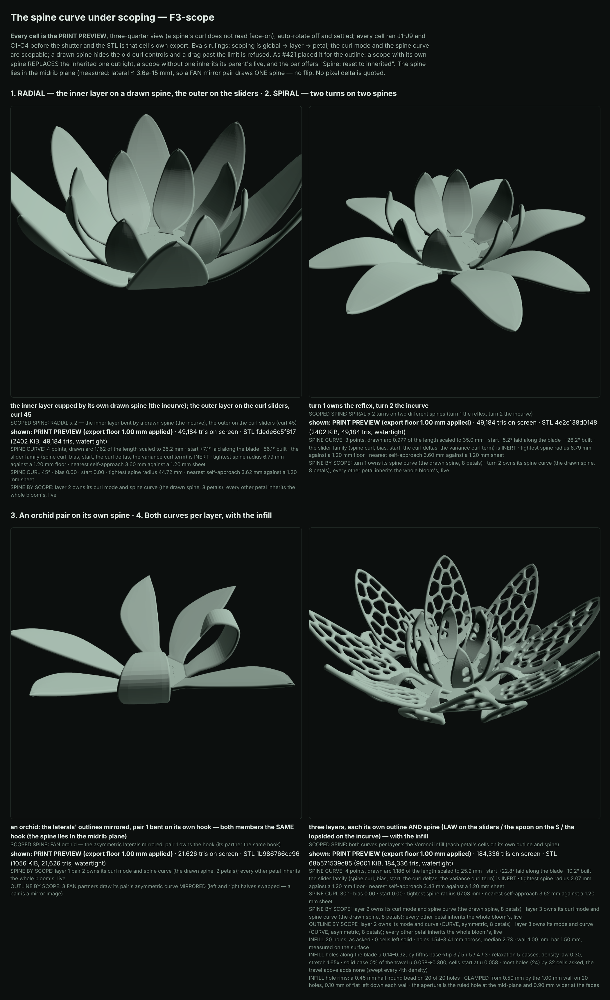

# The spine curve under scoping — F3-scope

*Session of Oct 19. Eva's rulings for this session, not re-litigated: scoping is global → layer → petal;
per-layer on RADIAL and SPIRAL, per-petal on FAN only (mirror pairs linked; re-link takes the selected
petal); selection loads values and never applies them; sheet thickness is never scoped. The spine-curve
rulings stand (the points draw the shape, the old curl controls hide while it is on, a drag past the limit
is refused). **The curl mode toggle and the spine curve are both scopable.** Petals only — sepals and
leaves get spine and outline curves in the next session. Read `docs/bloom-outline-curve-scope-outcome.md`
first: this session follows #421's model exactly and builds no second one.*

## 1. The model: #421's, extended — one chain, one resolver, two value groups

The curl mode (`petalCurlMode`, SLIDER / CURVE) and the spine curve (`petalSpineCurve`) join the outline's
two ids as values a scope OWNS:

```
values: { petalOutlineMode?, petalOutlineCurve?, petalCurlMode?, petalSpineCurve? }
```

- `SCOPE_VALUE_GROUPS` (`bloom-geometry.js`) is the one split — `outline` and `spine` — and
  `SCOPE_VALUE_IDS` is now derived from it. `scopeValueGroup(id)` names an id's group.
- **One resolver.** #421's `resolvePetalOutline` is extended and renamed `resolvePetalValues`; it takes
  every owned id from the scope term, then applies the FAN mirror to the outline's halves. There is no
  second function for the spine: the chain (`scopeOffsetsFor`: layer entries, then petal entries, behind
  the two toggles), the precedence and the live inheritance are one for both groups. The apex table's
  `the-spine-resolved-through-a-second-chain` is the standing mutant against a spine chain beside it.
- **Every caller now reads the petal's own spine** because every reader already read `ps`:

| caller | reads |
|---|---|
| `petalFormIsFlat` (is a form built at all) | `ps` — a scoped CURVE builds a form on a petal whose sliders are flat |
| `petalForm`'s one curl read (`curlRad = 0` in CURVE mode) | `ps` |
| the builder's `spineCurveLaw` and its refusal record (`curveRefusal`) | `form.spineCurve` / `ps` |
| the sepal scan's congruence key | already serialises `scopeTerm.values` — the spine values included |
| the petal record | new `spineFrom` (which scope owns the curl mode / curve), beside `outlineFrom` (now cut to the outline group) |
| `scopesBuilt` | new `petalsSpineOwned` |
| bloom.js `curveValidatorCtx` | the spine's asked lengths only from the petals the edit REACHES (`spineEditReaches`: under a pick its scope; with none, the petals no scope owns a spine curve for) |
| bloom.js read-out | `SPINE CURVE` and `SPINE CURL` lines per kind of ring (a mixed flower prints both), plus `SPINE BY SCOPE` |
| bloom.js scope view, notes, resets, picker | generic over `SCOPE_VALUE_IDS`; the reset is per group |
| bloom-file.js | generic over `SCOPE_VALUE_IDS` through `FIELD_KINDS` — no code change, a header note |
| harness C1 / J8 (per ring), `formAssertions` (rep petal), new C4 (per petal) | `spineRestated` — RESTATED from the controls and the row's `@scopes` through `scopedValuesRestated`, the ONE restatement both `outlineRestated` and `spineRestated` read |
| `verify-bloom-surface-bytes` | `--movers-predicate scope-spine` |

**Placements carried over from #421, not re-decided:** an owned spine REPLACES the inherited one outright;
an unowned scope inherits its parent's live; "Spine: reset to inherited" in the scope bar (beside
"Outline: reset to inherited"); an edit equal to the inherited value is pruned; dragging an inherited
curve makes it owned at the picked scope. **One placement this session adds:** the two resets are PER
GROUP — the spine's removes `petalCurlMode` / `petalSpineCurve` and keeps an outline the same scope owns,
and the outline's keeps the spine (panel route (aj) asserts it; its mutant `the spine reset drops the
outline too` must fire).

Empty values are the identity BY BRANCH as before (`scopeTerm.values` exists only where a live entry owns
one). A whole bloom with no spine values builds every row it built: §4.

## 2. The FAN mirror pairs — measured first: the spine is PLANAR, the mirror is the identity

`buildPetalInto`'s `spineAt` lays every spine point at `base + Rs·dR + Up·dZ` — the foot's own radial and
up directions, the curl plane — and the drawn curve's `y` is the curl plane's. Nothing in the law has a
term across the petal (twist turns the cross-section about the spine, never the spine). **Measured** on a
FAN pair owning a drawn spine (`probe`, EXPORT, the shipping fan): every spine row of every petal, taken
from the first and resolved about the petal's own azimuth, has a lateral component of at most
**3.6e-15 mm** — and the same with twist 40°, a dome at rise 0.5, cup 0.6 and an asymmetric outline on top;
the partner's in-plane rows equal the canonical member's **exactly (0)**. A curve with no lateral component
is its own mirror image, so **the partner draws its pair's spine UNCHANGED** — consistent with Eva's Oct 18
mirror-image ruling, which on a planar curve says nothing more. The resolver therefore has no spine arm in
its mirror, and that is asserted rather than argued:

- **C4 (c)** — every emitted spine is planar in its petal's midrib plane (1e-9 mm), on every petal of every
  row with a curve or a scope;
- **C4 (d)** — on a FAN, a pair's two spines in their own planes agree to 1e-9 mm and their laws' records
  and built turns are the same doubles;
- **`the-fan-partner-spine-is-flipped`** (apex table) applies the outline's mirror to the spine — the
  partner bends the other way — and C4 is what fires.

## 3. The page

- `#scopeSpineReset` ("Spine: reset to inherited") beside `#scopeOutlineReset`, each shown iff the picked
  scope owns a value of its group (`resetScopeValues(group)`).
- The notes under the two spine controls say whose spine is in view — `Layer 2: its OWN spine curve …` or
  `INHERITED from the whole bloom, live …` — and under a FAN pair pick, that the pair's other petal draws
  the SAME spine. With nothing picked, the spine-curve note names the scopes that bend their own.
- **The old curl controls follow the picked scope's effective curl mode** — spine curl, curl bias and curl
  start are hidden on a scope that owns CURVE and shown on one that inherits SLIDER. Nothing new was needed:
  `viewUi` spreads the scope's effective values (now including `petalCurlMode`) under the pick, the (ai)
  mechanism. Route (aj) is the witness, and its mutant `curl visibility reads the whole bloom's curl mode`
  must fire.
- **The validator asks the lengths the edit reaches.** A picked inner layer's drag is refused at ITS
  length; a whole-bloom drag is not refused for an inner layer that owns its own (tighter) spine.
- **Found and fixed, pre-existing since F3-global:** the three SEPAL curl twins (`sepalSpineCurl`,
  `sepalCurlBias`, `sepalCurlStart`) HID whenever the petals' spine was CURVE, while the slider-pinned sepal
  still read every one of them — block 62's own row "x 5 sepals at curl 60" set a value the panel could not
  show. #418's twin-predicate fix for the outline, for the spine: `twinPredicate` drops `curlFromSlider`.
  Panel visibility only; no byte moves.

## 4. Verification

- **The byte partition** — `node tools/verify-bloom-surface-bytes.mjs --base <worktree of 971155c>
  --movers-predicate scope-spine`, the whole 1,396-row matrix in both modes: **PASS — 14 predeclared MOVERS / 1,382 HOLDERS, 0 floats moved on any holder, positionally under `Object.is`, over 1,683,700,848 export floats (187,077,872 triangles) and 80,750,156 captured-grid values**. The run was three `--range` shards (0:466, 466:932, 932:1396), every one PASS. The 14 movers are block 70's rows less its two GATED rows, and those two hold BIT-IDENTICALLY, measured: a record kept inert behind its toggle, and a spine curve owned under every-SLIDER mode. All 1,380 of `main`'s rows are holders. The predicate
  decides a mover from the harness's RESTATED spine against the whole bloom's; every row of `main`'s 1,380
  owns no spine value. The tool learned one thing: the base tree REFUSES a value id it does not list (its
  `checkScopeValues`), and its page tells such a value "not applied"; so the base is handed the record with
  the values it cannot own dropped (`baseScopes`), which is that file on the base page. A record whose
  values the base knows is handed unchanged.
- **The export gate** over blocks 62, 68 and 70 (`--only '^(SCOPED SPINE|SPINE CURVE|SCOPED OUTLINE)'`):
  **43 rows, every one watertight, 0 degenerate, live and export triangle counts equal; 42 free of within-shell self-intersection and ONE new fold**, on `SCOPED SPINE: both curves per layer x cup 0.6` — 248 pairs / 0.1713 mm on layer 2 (the spoon on the S), mid-blade at the margin. The fold is NOT caused by the scoping, and the control is main's own geometry: the SAME composition with no scope at all (one layer, spoon + S + cup 0.6) reads **248 pairs on 971155c and on this tree alike**. LAW + S + cup 0.6 reads 344. Spoon + S at cup 0 reads 0, and spoon + cup 0.6 on the sliders reads 0. Scoped, layer 2 owning only the S reads 376, and owning only the spoon reads 0. So it is the drawn S spine × cup product: a two-control composition the one-control-at-a-time matrix cannot see. This row reached it because it was written to put a cup on every scoped spine. It is declared in `SELF_INTERSECTION_XFAIL` with those controls in its note, never tuned around. The browser then confirmed it at exactly its record (`--only`, X1: still failing at that magnitude).
- **Census:** **no fold the scoping makes.** The one new entry above is the drawn-spine × cup composition, which main already makes unscoped. The other fifteen block-70 rows read 0 within-shell pairs, and every declared row in blocks 62 and 68 reproduces its record (X1).
- **C4** is new (smoke census: 188 families, both ways); **C1 / J8** read each ring's own spine;
  `formAssertions` reads the representative petal's.
- **Apex mutant table — five witnessed mutants** (`--only=` the five, `--rows='^a scoped spine'`):
  `a-scoped-spine-is-ignored`, `a-scoped-spine-leaks-to-sibling-layers`, `a-scoped-spine-leaks-to-sibling-
  pairs`, `the-spine-resolved-through-a-second-chain`, `the-fan-partner-spine-is-flipped`. **6 of 6 behave** (the five, plus `a-scoped-outline-is-ignored` re-anchored), each firing what it names on the mutated module, with the clean tree silent on all seven rows. A subset, not a sweep: 196 mutants were not run.
  `a-scoped-outline-is-ignored` was re-anchored (the resolver's rename); 202 of 202 anchors match once.
- **Panel route (aj)** — the spine under scoping, five bloom.js mutants (a pick that writes the spine; the
  spine reset leaving the owned curve; an inherited spine frozen at copy time; the spine reset dropping the
  outline; curl visibility reading the whole bloom's mode). Route (ah)'s two mutants re-anchored onto the
  per-group reset and `isCurveId`. TWENTY-SEVEN routes. The panel gate passes. **`--negative-control`: ALL TWENTY-SEVEN ROUTES observed the failure they exist to catch**, including each of (aj)'s five, each reported by its own sentence.
- **Design file F14**: per-scope spines (a layer owning mode, spine and outline; a pair owning a spine)
  round-trip verbatim with no note; a #421-shaped file loads clean with no spine invented; a bad curl mode,
  an out-of-box spine and a two-sided spine are refused and told; a tier's told not applied. `--no-browser`
  PASS (11 clauses; F2: 1,396 of 1,396 live rows round-trip clean). The three value mutants claim F14.
- **Matrix:** block 70, sixteen rows (1,380 → 1,396); smoke block 70, six rows, `--conn`.
  `frozen/phase76` = the 1,380 rows at `971155c`, registered in both maps, `--verify-frozen` PASS.
- **Sheet:** `node tools/shot-bloom-spine-scope.mjs <dir> --png docs/img/spine-scope.png`. Four cells, print preview ON, three-quarter view, each asserting J and C1-C4 and exporting watertight: the RADIAL inner layer cupped by the incurve beside an outer layer on curl 45 (49,184 tris); the SPIRAL's two turns on the reflex and the incurve (49,184); the orchid pair bent on one hook, partners unflipped (21,626); the both-curves flower with the infill (184,336). The cells' print-preview wait had to be 300 s, because the infill cell's export rebuild passed the harness's 30 s default on a loaded box. No pixel delta is quoted. 

## 5. Cost

Zero triangles on every row with no spine value, and the spine changes where rows go, never how many — a
drawn spine is the same lattice bent. Measured, EXPORT and LIVE equal on every block-70 row: the two-layer rows 49,184 tris (2,402 KiB), the three-layer rows 73,680 (3,598 KiB), the FAN rows 21,626 (1,056 KiB, 18,564 through the gap). Each count is the same as its unscoped twin's at the same layer count, because a spine bends the lattice and does not add to it. The costliest row is the both-curves flower with the infill, **184,336 tris (9,001 KiB), 12.3% of the export budget**. The shipping default is untouched at 24,688.

## 6. Not done, and named

- Sepals and leaves: spine and outline curves (the next session, by the brief).
- A tier's values are told `not applied` (spine and outline alike).
- The combination gate's curl pairs read `petalSpineCurl`, inert in CURVE mode (F3-global §8) — unchanged.
